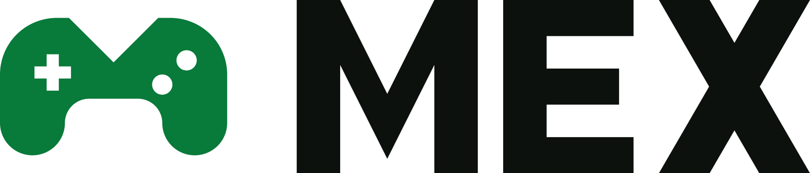
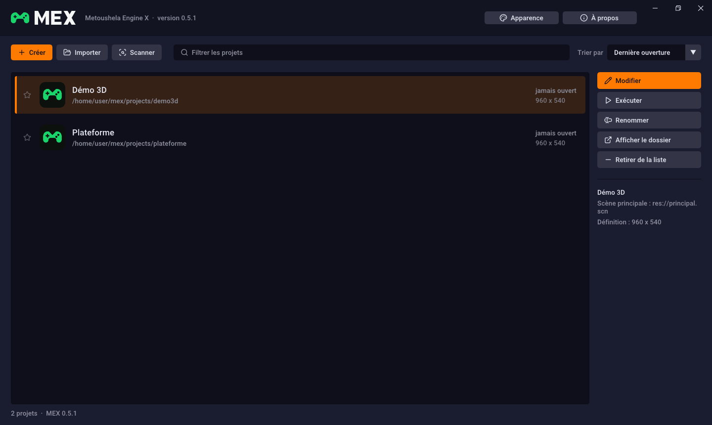
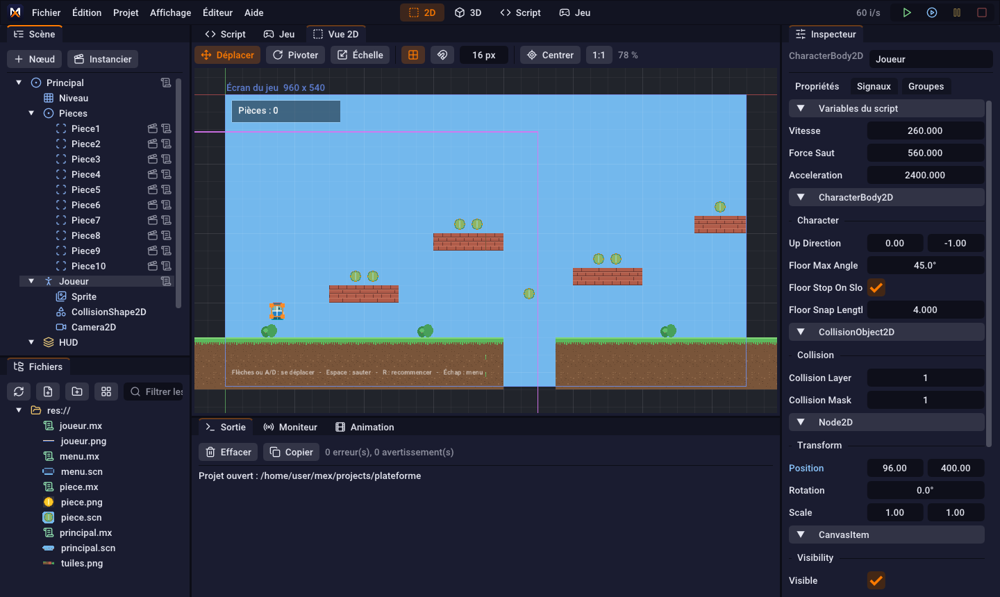
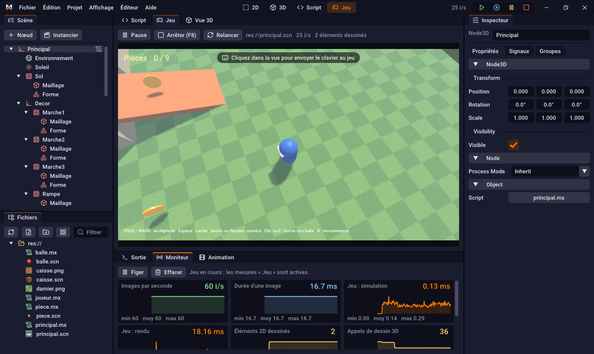
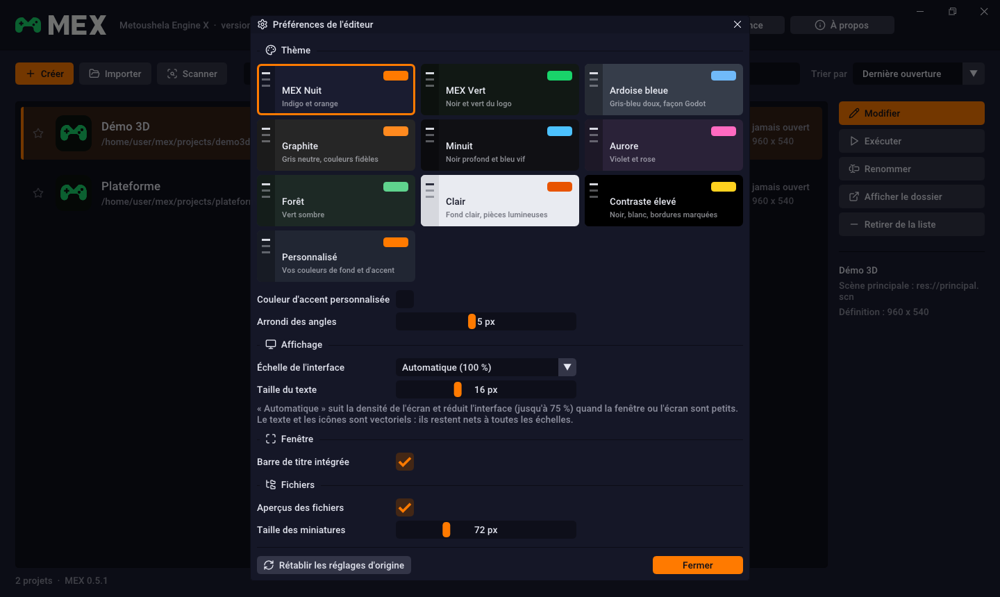
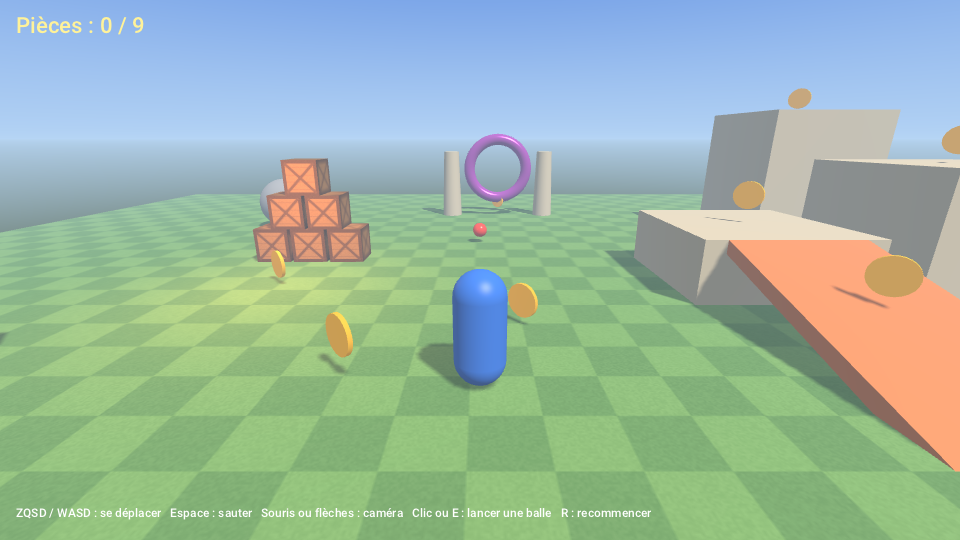
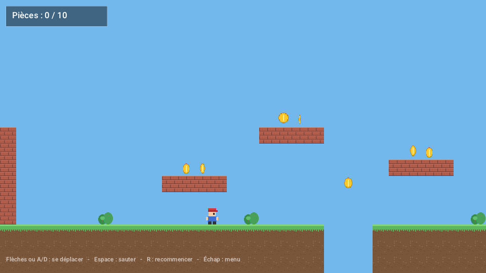
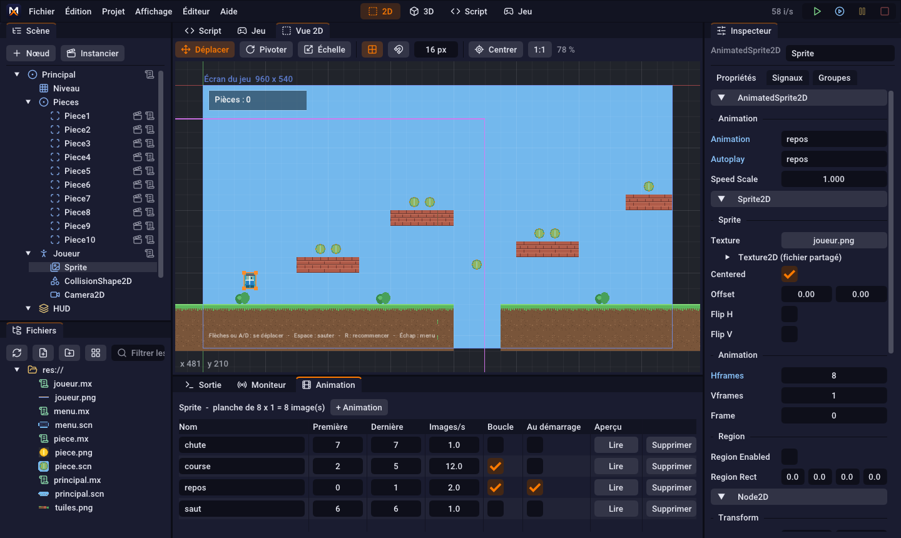
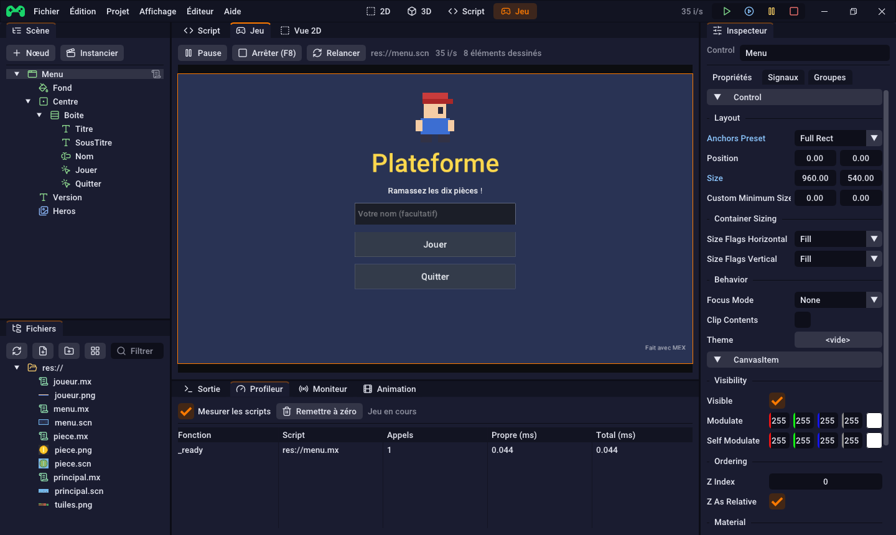
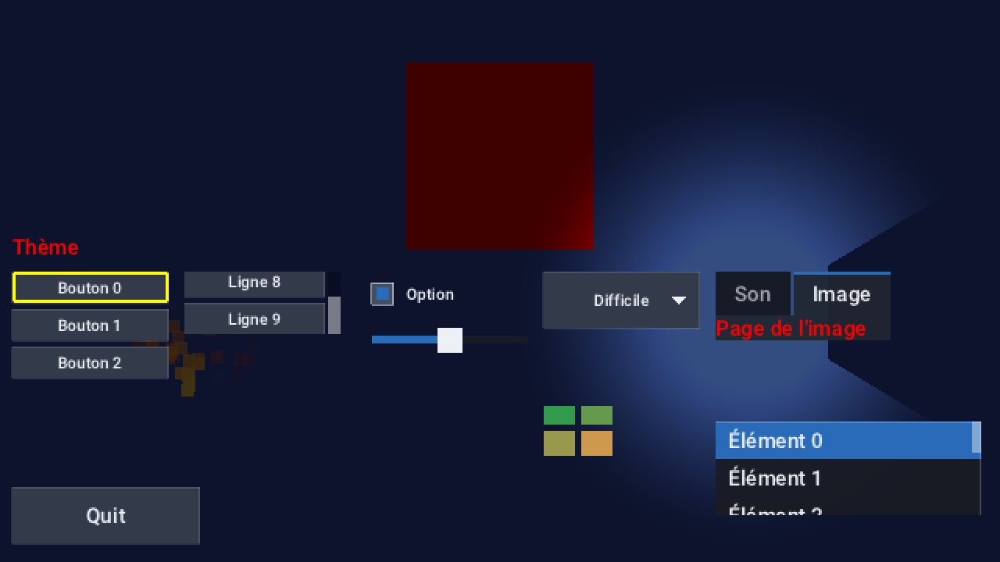

<p align="center">
  <picture>
    <source media="(prefers-color-scheme: dark)" srcset="branding/png/mex-horizontal-dark.png">
    
  </picture>
</p>

# MEX — Metoushela Engine X

**MEX** (*Metoushela Engine X*) est un moteur de jeu 2D et 3D écrit en C++17, avec son éditeur
et son langage de script, **MexScript**. Son architecture s'inspire de celle de Godot :
objets réfléchis (`Object` / `ClassDB`), `Variant`, arbre de nœuds, serveurs de rendu et de
physique, ressources, scènes au format texte, langage de script intégré, éditeur visuel,
animation, interface de jeu à ancres et conteneurs, export de jeux autonomes.





## Télécharger

Les versions compilées sont publiées dans la page **Releases** du dépôt GitHub (voir
[Publier une version](#publier-une-version-avec-github)). Sous Windows et sous Linux, MEX
tient en **un seul fichier** : l'éditeur, avec les modèles d'export de tous les systèmes à
l'intérieur. Rien à décompresser, aucune bibliothèque à installer.

| Système | Fichier | Pour lancer |
| --- | --- | --- |
| Windows 10 ou 11, 64 bits | `mex-<version>-windows-x86_64.exe` | Double-cliquez dessus |
| Linux x86_64, glibc 2.39 ou plus récente (Ubuntu 24.04, Debian 13, Fedora 40...) | `mex-<version>-linux-x86_64` | `chmod +x mex-*-linux-x86_64` puis `./mex-*-linux-x86_64` |
| macOS 11 ou plus récent, Intel et Apple Silicon | `mex-<version>-macos-universal.tar.gz` | `xattr -dr com.apple.quarantine .` puis `./mex` |

Fichiers facultatifs :

- `mex-<version>-windows-x86_64.console.exe` : la [version console](#version-console-windows)
  pour Windows, à placer à côté du `.exe` ;
- `mex-<version>-exemples.zip` : les deux [projets d'exemple](#projets-dexemple) ;
- `mex-<version>-modeles-export.tpz` : le paquet des [modèles d'export](#modèles-dexport) de
  tous les systèmes.

**Archives complètes.** Chaque publication contient aussi, pour chaque système, tout ce que
la compilation a produit, avec les modèles d'export de **tous** les systèmes :

| Fichier | Contenu |
| --- | --- |
| `mex-<version>-windows-x86_64.zip` | `mex.exe`, `mex.console.exe`, `mex-jeu.exe`, `LISEZMOI.txt`, `templates/` |
| `mex-<version>-linux-x86_64.tar.gz` | `mex`, `mex-jeu`, `LISEZMOI.txt`, `templates/` |
| `mex-<version>-macos-universal.tar.gz` | `mex`, `mex-jeu`, `LISEZMOI.txt`, `templates/` |
| `mex-<version>-web-wasm32.zip` | `mex-jeu.js`, le modèle d'export web seul |

Le dossier `templates/` est le même dans les trois archives : `windows-x86_64/mex-jeu.exe`,
`linux-x86_64/mex-jeu`, `macos-universal/mex-jeu`, `web-wasm32/mex-jeu.js` et `version.txt`.
L'éditeur le trouve à côté de lui : rien à installer pour exporter vers un autre système.
`mex-jeu` lance un projet sans l'éditeur (`mex-jeu --path <dossier>`).

Sous macOS, un exécutable signé ne peut rien recevoir à sa suite : l'archive contient donc
l'éditeur `mex`, le modèle `mex-jeu` et un dossier `templates/` pour les autres systèmes. La
commande `xattr` lève le blocage appliqué aux programmes téléchargés qui ne sont pas signés
par un développeur identifié. Sous Windows, SmartScreen peut afficher « Windows a protégé
votre ordinateur » : cliquez sur *Informations complémentaires* puis *Exécuter quand même*.

Les préférences, la liste des projets et les modèles d'export extraits de l'éditeur sont
rangés dans le dossier de données de l'utilisateur (`%APPDATA%\Metoushela\MEX` sous
Windows) : le fichier téléchargé peut être déplacé ou remplacé par une version plus récente
sans rien perdre.

## Compiler

Dépendances : un compilateur C++17, CMake 3.16 ou plus récent, SDL2. Le reste
(Dear ImGui, stb, police Roboto) est fourni dans `thirdparty/`.

La 3D utilise OpenGL 2.1, fourni par le pilote graphique : il n'y a ni en-tête ni
bibliothèque OpenGL à installer pour compiler, les fonctions sont résolues à l'exécution.

**Linux (Debian / Ubuntu)**

```sh
sudo apt install build-essential cmake ninja-build libsdl2-dev
cmake -S . -B build -G Ninja
cmake --build build
./build/bin/mex
```

**Windows (MSYS2)** : installez [MSYS2](https://www.msys2.org), ouvrez le terminal
« MSYS2 UCRT64 », puis :

```sh
pacman -S --needed mingw-w64-ucrt-x86_64-gcc mingw-w64-ucrt-x86_64-cmake mingw-w64-ucrt-x86_64-ninja
cmake -S . -B build -G Ninja -DMEX_VENDORED_SDL=ON -DMEX_STATIC_RUNTIME=ON
cmake --build build
./build/bin/mex.exe
```

**Windows (Visual Studio 2019 ou plus récent, avec vcpkg)**

```bat
vcpkg install sdl2:x64-windows
cmake -S . -B build -DCMAKE_TOOLCHAIN_FILE=C:/vcpkg/scripts/buildsystems/vcpkg.cmake
cmake --build build --config Release
build\bin\mex.exe
```

**macOS**

```sh
brew install cmake
cmake -S . -B build -DMEX_VENDORED_SDL=ON
cmake --build build --parallel
./build/bin/mex
```

**Windows depuis Linux (compilation croisée avec MinGW-w64)**

```sh
sudo apt install g++-mingw-w64-x86-64-posix
cmake -S . -B build/windows -G Ninja -DCMAKE_TOOLCHAIN_FILE=cmake/toolchain-mingw-w64.cmake \
    -DMEX_VENDORED_SDL=ON -DMEX_STATIC_RUNTIME=ON
cmake --build build/windows
```

La compilation produit deux exécutables dans `build/bin` : `mex` (moteur et éditeur) et
`mex-jeu` (moteur seul, copié par *Exporter le jeu*).

Options CMake :

| Option | Défaut | Rôle |
| --- | --- | --- |
| `MEX_BUILD_EDITOR` | `ON` | Inclut l'éditeur dans `mex`. `OFF` : `mex` est un exécutable de jeu seul. |
| `MEX_BUILD_TEMPLATE` | `ON` | Compile aussi `mex-jeu`. |
| `MEX_VENDORED_SDL` | `OFF` | Télécharge SDL2 2.32.10 et la lie statiquement : l'exécutable ne dépend plus d'une SDL2 installée. Sous Linux, `libsdl2-dev` reste utile pour les en-têtes de X11, Wayland et de l'audio. |
| `MEX_STATIC_RUNTIME` | `OFF` | GCC et MinGW : lie statiquement les bibliothèques du compilateur. Sous Windows, aucune DLL n'accompagne alors l'exécutable. |
| `MEX_WINDOWS_GUI` | `ON` | Windows : pas de fenêtre de console. Les messages restent visibles quand le programme est lancé depuis un terminal. |
| `MEX_VERSION` | vide | Numéro de version affiché par `mex --version`. Vide : celui de `project()` dans `CMakeLists.txt` (0.11.4). |
| `MEX_SANITIZE` | `OFF` | AddressSanitizer et UBSan (GCC / Clang). |

> Ce qui a été essayé : la compilation sous Linux avec GCC 14 et avec Clang 19 (libc++) ;
> la compilation croisée vers Windows avec MinGW-w64, dont les exécutables ont été lancés
> avec Wine. La 3D a été essayée sous Linux et sous Wine avec l'OpenGL logiciel de Mesa
> (llvmpipe), pas avec un pilote de carte graphique. Les compilations sous MSYS2, Visual
> Studio et macOS n'ont pas été essayées sur ces systèmes, et la 3D n'a tourné ni sur un
> vrai Windows ni sur macOS : pour ces systèmes, c'est GitHub Actions qui fait foi pour la
> compilation (voir [Publier une version](#publier-une-version-avec-github)), et le rendu
> 3D reste à vérifier sur une machine réelle.

## Lancer

```sh
mex                                    # gestionnaire de projets, puis éditeur
mex -e --path projects/plateforme      # ouvre le projet d'exemple dans l'éditeur
mex --path projects/plateforme         # lance le jeu
mex --path projects/demo3d             # lance la démonstration 3D
```

| Option | Rôle |
| --- | --- |
| `-e`, `--editor` | Ouvre l'éditeur |
| `--path <dossier>` | Dossier du projet (celui qui contient `project.mex`) |
| `<scène>` | Scène à lancer ou à ouvrir, par exemple `res://niveau.scn` |
| `--main-pack <f.pck>` | Lance le jeu contenu dans une archive exportée |
| `--quit-after <n>` | Quitte après `n` images |
| `--screenshot <f.bmp>` | Enregistre la dernière image |
| `--hidden` | Fenêtre masquée |
| `--sans-echec` | Mode de compatibilité pour cette fois : barre de titre du système, pilote de rendu le plus sûr (sans 3D) |
| `--export <préréglage>` | Exporte le projet sans ouvrir de fenêtre (voir [Exporter un jeu](#exporter-un-jeu)) |
| `--incorporer-modeles <sortie> ...` | Écrit une copie de l'éditeur qui contient des modèles d'export (voir [Modèles d'export](#modèles-dexport)) |
| `--installer-modeles <paquet.tpz>` | Installe un paquet de modèles d'export (voir [Modèles d'export](#modèles-dexport)) |
| `--licences` | Affiche les licences des composants utilisés (éditeur et jeux exportés) |
| `--version`, `--help` | Version, aide |

En jeu, F11 bascule le plein écran.

### Version console (Windows)

Sous Windows, `mex.exe` est une application graphique : lancée d'un double-clic, elle n'ouvre
pas de fenêtre noire, et dans un terminal ses messages n'apparaissent pas. Comme Godot
(`godot.console.exe`), MEX fournit donc `mex.console.exe`, un petit lanceur à placer **à côté
de l'éditeur** : il démarre l'éditeur dans le terminal, y affiche ses messages (`print` des
scripts, erreurs, résultat d'un export) et rend son code de retour.

```bat
mex-v0.11.4-windows-x86_64.console.exe --path mon_projet --export "*"
mex-v0.11.4-windows-x86_64.console.exe --version
```

Le lanceur cherche l'éditeur qui porte le même nom que lui sans `.console` : renommez les
deux fichiers ensemble (`mex.exe` et `mex.console.exe`, par exemple).

| Variable d'environnement | Rôle |
| --- | --- |
| `MEX_SCREEN_SCALE` | Impose l'échelle de l'écran (`1`, `1.5`, `2`...) au lieu de celle que déclare le système |
| `MEX_EDITOR_SCALE` | Impose l'échelle de l'interface de l'éditeur, sans toucher aux préférences |
| `MEX_EDITOR_THEME` | Impose le thème de l'éditeur, par exemple `Clair` |
| `MEX_RENDER_DRIVER` | Impose un pilote de rendu SDL (`opengl`, `direct3d`, `direct3d11`, `software`, `metal`...) |

### Pilote de rendu et mode de compatibilité

La 3D, les shaders 2D et les lumières 2D ont besoin du pilote de rendu `opengl`. Le moteur
l'essaie donc en premier, puis **contrôle le pilote OpenGL de la carte graphique** avant de
s'en servir. Un mauvais pilote OpenGL ne refuse pas de démarrer : il donne une image fausse
(vues blanches, image décalée, lenteur). Il est écarté dans quatre cas :

- Windows sans pilote du fabricant de la carte (« GDI Generic », OpenGL 1.1 calculé par le
  processeur) ;
- OpenGL plus ancien que 2.1 ;
- pas de dessin dans une texture ;
- **essai de dessin** manqué : au démarrage, le moteur dessine un fond, un rectangle, un
  triangle et une petite image dans une texture cachée, puis relit le résultat. Des couleurs
  ou des positions fausses écartent le pilote.

> **Changement de la version 0.11.** Jusqu'à la version 0.10, Windows exigeait OpenGL 3.3 :
> sur un ordinateur dont la carte s'arrête à OpenGL 2.1, 3.0, 3.1 ou 3.2, la vue 3D affichait
> « OpenGL n'est pas disponible » alors que le rendu 3D de MEX n'a besoin que d'OpenGL 2.1.
> Ce seuil est supprimé ; c'est l'essai de dessin qui juge le pilote, pas son âge.

Quand la vue 3D ne peut pas s'afficher, elle dit maintenant **pourquoi** (pilote choisi dans
les préférences, mode de compatibilité, pilote écarté et raison) et propose le bouton
**Activer OpenGL**, qui règle le pilote de rendu sur OpenGL pour le démarrage suivant.

Le moteur prend alors le pilote habituel du système (Direct3D sous Windows), puis le rendu
logiciel. La 2D fonctionne normalement, la 3D, les shaders et les lumières 2D sont
désactivés, et la raison est écrite dans la *Sortie* de l'éditeur.

| Réglage | Où |
| --- | --- |
| Éditeur | *Éditeur > Préférences... > Fenêtre > Pilote de rendu* (au prochain démarrage) |
| Jeu | `rendering/driver` dans `project.mex` : `"auto"`, `"opengl"`, `"direct3d"`, `"direct3d11"`, `"software"` |
| Pour une fois | variable `MEX_RENDER_DRIVER`, qui passe avant les deux autres |

Un pilote choisi à la main est pris tel quel, sans contrôle.

Le **mode de compatibilité** réunit les deux réglages les plus sûrs : barre de titre du
système et Direct3D 9 sous Windows (rendu logiciel ailleurs). Trois façons de l'activer :

- la question **« L'affichage est-il correct ? »**, posée en bas à droite la première fois
  qu'une combinaison (pilote de rendu, barre de titre) est utilisée sur la machine :
  *Mode de compatibilité*, puis fermer et relancer MEX ; *Oui, tout va bien* ne repose plus
  la question ;
- *Éditeur > Préférences... > Fenêtre > Mode de compatibilité* ;
- sous Windows, le fichier `mex-sans-echec.bat` livré à côté de `mex.exe`, ou
  `mex --sans-echec` : valable pour ce lancement, les préférences ne changent pas.

*Aide > À propos* affiche l'état de l'affichage (système, écrans, échelle, taille de la
fenêtre, pilote de rendu, version d'OpenGL et carte), avec un bouton pour le copier. Le
même texte est écrit à chaque démarrage de l'éditeur dans `diagnostic.txt`, dans le dossier
de préférences (`%APPDATA%\Metoushela\MEX` sous Windows,
`~/.local/share/Metoushela/MEX` sous Linux). Joignez-le à tout signalement de problème
d'affichage.

## Premiers pas

1. Ouvrez le projet d'exemple dans l'éditeur. Depuis une archive téléchargée :
   `./mex -e --path projects/plateforme` (sous Windows, dans un terminal ouvert dans le
   dossier : `mex.exe -e --path projects\plateforme`). Après une compilation, l'exécutable
   est `build/bin/mex`.
2. Appuyez sur **F5** : le jeu démarre dans l'onglet *Jeu*. Cliquez dans l'image pour lui
   donner le clavier ; **F8** l'arrête.
3. Dans le dock *Fichiers*, double-cliquez sur `principal.scn`, sélectionnez `Niveau` puis
   *Peindre les tuiles* pour modifier le décor. Ctrl+S enregistre.
4. Sélectionnez `Joueur > Sprite` : le dock *Animation* liste ses animations ; *Lire* en
   montre un aperçu.
5. Pour la 3D, ouvrez l'autre exemple : `./mex -e --path projects/demo3d`. Le bouton droit
   de la souris fait tourner la vue ; cliquez sur un objet puis tirez une flèche du
   manipulateur pour le déplacer. **F5** lance la démonstration.
6. Pour créer votre propre jeu, lancez `mex` sans argument : dans le gestionnaire de
   projets, cliquez sur *Créer*, choisissez un nom, un dossier et un modèle de départ
   (projet vide, jeu 2D ou jeu 3D), puis *Créer et modifier*.

Si la fenêtre ne s'ouvre pas, lancez la commande depuis un terminal : les erreurs y sont
affichées, précédées de `ERREUR:`.

## L'éditeur

### Gestionnaire de projets

`mex` lancé sans projet ouvre la page d'accueil, organisée comme celle de Godot : la liste
des projets au centre, les actions à droite.

| Commande | Rôle |
| --- | --- |
| *Créer* | Nouveau projet à partir d'un modèle : vide, jeu 2D (caméra et titre) ou jeu 3D (sol, cube, caméra, soleil, ciel) |
| *Importer* | Ajoute un projet existant : choisissez son dossier, celui qui contient `project.mex` |
| *Scanner* | Cherche des projets dans un dossier et ses sous-dossiers |
| Filtre et tri | Par nom, chemin, date de dernière ouverture ; l'étoile épingle un favori en tête de liste |
| *Modifier* (ou double-clic) | Ouvre le projet dans l'éditeur |
| *Exécuter* | Ouvre le projet et lance aussitôt le jeu |
| *Renommer*, *Afficher le dossier*, *Retirer de la liste* | Retirer n'efface aucun fichier |

Chaque projet a son **logo** dans la liste : l'image du réglage *Icône de la fenêtre* du
projet, sinon un logo fabriqué par MEX (un carré arrondi en dégradé avec l'initiale du nom ;
la couleur est tirée du nom, elle ne change donc pas d'un lancement à l'autre). Un projet
créé depuis cette page reçoit ce logo dans un fichier `icon.png`, déclaré comme icône du
jeu : remplacez le fichier par votre image quand vous en avez une.

La liste est enregistrée dans `projects.cfg`, à côté des préférences de l'éditeur. Depuis
l'éditeur, *Projet > Retourner à la liste des projets* y revient sans relancer le programme.

### Fenêtre principale

La barre du haut réunit les menus, le choix de l'espace de travail (**2D**, **3D**,
**Script**, **Jeu**) et les commandes de lecture (lancer le projet, lancer la scène
ouverte, pause, arrêt).

| Dock | Rôle |
| --- | --- |
| Scène | Arbre des nœuds, avec une icône par type : ajout, renommage (F2), duplication (Ctrl+D), glisser-déposer pour changer de parent, instanciation de scènes |
| Vue 2D | Déplacer (Q), pivoter (E), redimensionner (R), centrer (F) ; molette pour zoomer, bouton du milieu ou droit pour déplacer la vue ; peinture de tuiles pour les `TileMap` |
| Vue 3D | Le même dock, qui passe en 3D quand un nœud 3D est sélectionné (boutons *2D* / *3D* de la barre du haut pour forcer). Voir ci-dessous |
| Inspecteur | Propriétés, variables exportées des scripts, signaux et groupes ; aperçu des textures, des maillages et des matériaux |
| Fichiers | Fichiers du projet, en arborescence ou en grille de miniatures ; filtre, double-clic pour ouvrir, glisser vers la vue ou l'inspecteur |
| Script | Éditeur de texte avec indentation automatique et vérification à l'enregistrement |
| Jeu | Le jeu en cours d'exécution (F5 : projet, F6 : scène courante, F8 : arrêter) |
| Sortie | Messages, avertissements et erreurs |
| Moniteur | Courbes en temps réel : images par seconde, durée d'une image, coût de la simulation et du rendu du jeu, éléments 2D, appels de dessin et triangles 3D, nœuds, objets en mémoire |
| Animation | Animations du `AnimationPlayer` ou de l'`AnimatedSprite2D` sélectionné |

Ctrl+S enregistre, Ctrl+Z annule, Ctrl+Y rétablit. Les touches des actions se règlent dans
*Projet > Paramètres du projet > Contrôles*. *Projet > Exporter le jeu...* produit un jeu autonome.

### Barre de titre et taille de la fenêtre

Sous Linux, la fenêtre de l'éditeur n'a pas de barre de titre séparée : les boutons
**Réduire**, **Agrandir / Restaurer** et **Fermer** sont dans la barre du haut, à droite,
aux couleurs du thème. Sous **Windows** et **macOS**, la barre de titre du système est
utilisée par défaut.

> **Windows et cartes graphiques Intel.** Jusqu'à la version 0.7.0, la barre intégrée était
> activée d'office sous Windows. Avec certains pilotes OpenGL d'Intel (constaté sur une
> HD Graphics 5500, pilote 20.19.15.5126, Windows 10 à 150 %), l'image est alors dessinée
> décalée alors que la souris reste à sa place : les menus s'affichent mal et aucun bouton
> ne répond. Depuis la 0.7.1, la barre du système est le choix par défaut sous Windows, et
> l'ancienne préférence est ignorée. La barre intégrée reste disponible dans les
> préférences ; si elle dérègle l'affichage, lancez `mex-sans-echec.bat` puis décochez-la.

| Geste | Effet |
| --- | --- |
| Glisser une zone vide de la barre du haut | Déplace la fenêtre |
| Double-clic sur une zone vide de la barre | Agrandit ou restaure |
| Glisser un bord ou un coin | Redimensionne |

*Éditeur > Préférences... > Fenêtre > Barre de titre intégrée*, décochée, rend la barre de
titre du système ; le changement est immédiat. Cette barre est alors demandée sombre quand
le thème est sombre : Windows 10 (version 2004) et 11 l'affichent sombre, Windows 11 lui
donne en plus la couleur du thème ; sous Linux, l'indication `_GTK_THEME_VARIANT` est
suivie par GNOME et les gestionnaires de fenêtres qui la lisent, pas par tous. Sous macOS,
la barre du système est le réglage d'origine : elle suit déjà l'apparence du système.

L'interface s'adapte à la taille de la fenêtre et de l'écran :

- la fenêtre s'ouvre agrandie, sans recouvrir la barre des tâches ; restaurée, elle tient
  toujours dans l'écran (sur un écran de 1366 x 768, elle est ramenée à 1157 x 691) ;
- avec l'échelle *Automatique*, l'interface rétrécit par pas de 5 %, jusqu'à 75 %, quand la
  fenêtre passe sous 1280 x 680 points ;
- la barre du haut se resserre : les espaces de travail ne gardent que leur icône, puis les
  menus se regroupent derrière un seul bouton ;
- les docks gardent leurs proportions quand la fenêtre change de taille ; dans un
  inspecteur étroit, les libellés passent au-dessus des champs ; les textes d'aide
  reviennent à la ligne ;
- les boîtes de dialogue et les fenêtres flottantes ne dépassent jamais de la fenêtre
  principale.

La fenêtre a une **taille minimale**, en dessous de laquelle elle ne peut pas être réduite :
960 x 600 points multipliés par l'échelle de l'interface, soit 720 x 450 avec l'échelle
automatique sur un écran ordinaire. Les docks et les fenêtres flottantes ont eux aussi une
taille minimale.

Pour un jeu, la taille minimale et la barre de titre se règlent dans
*Projet > Paramètres du projet > Affichage* :

| Paramètre | Valeur d'origine | Rôle |
| --- | --- | --- |
| `display/min_width` | 320 | Largeur minimale de la fenêtre du jeu |
| `display/min_height` | 180 | Hauteur minimale de la fenêtre du jeu |
| `display/dark_title_bar` | `true` | Demande une barre de titre sombre au système |

La variable d'environnement `MEX_EDITOR_TITLE_BAR=systeme` force la barre du système sans
toucher aux préférences.

### Aperçus et moniteur



| Fichier ou ressource | Aperçu |
| --- | --- |
| Image (`.png`, `.jpg`, `.bmp`...) | L'image, sur damier si elle est transparente, avec ses dimensions |
| Maillage `.obj` | Rendu 3D éclairé, nombre de triangles et de sommets |
| Scène `.scn` | Rendu de la scène, 2D ou 3D, sans exécuter ses scripts |
| Son `.wav` | Forme d'onde et durée |
| Script et texte | Premières lignes |
| Maillage ou matériau dans l'inspecteur | Rendu 3D à faire tourner à la souris ; un matériau est présenté sur une sphère |

Dans le dock *Fichiers*, les miniatures remplacent les icônes ; survoler un fichier affiche
son aperçu en grand, le sélectionner affiche sa fiche au bas du dock. Le bouton de la barre
du dock bascule entre arborescence et grille. Les aperçus se désactivent dans les
préférences ; le bouton *Actualiser* les recalcule.

### Thèmes et préférences



*Éditeur > Préférences...* (ou *Apparence* dans le gestionnaire de projets) règle :

- le **thème** : MEX Nuit (indigo et orange, celui d'origine), MEX Vert (noir et vert du logo), Ardoise bleue, Graphite, Minuit, Aurore, Forêt, Clair, Contraste
  élevé, ou Personnalisé (couleur de fond et couleur d'accent au choix) ;
- l'**échelle de l'interface** (automatique d'après l'écran, ou de 75 % à 300 %), la taille
  du texte et l'arrondi des angles ;
- la **barre de titre** : intégrée à l'éditeur ou celle du système ;
- les aperçus de fichiers et la taille des miniatures ;
- **script et jeu** : la taille du texte de l'éditeur de script (celle de l'interface, ou de
  10 à 32 px), l'enregistrement de la scène et du script avant chaque lancement du jeu
  (activé au départ), le vidage du panneau *Sortie* à chaque lancement ;
- **MEX Agent** : un bouton ouvre les réglages de connexion de l'assistant (voir
  [MEX Agent](#mex-agent)).

Les réglages sont enregistrés dans `editor_settings.cfg`, dans le dossier de données de
l'utilisateur (`%APPDATA%\Metoushela\MEX` sous Windows, `~/.local/share/Metoushela/MEX`
sous Linux, `~/Library/Application Support/Metoushela/MEX` sous macOS).

### Haute résolution

L'éditeur et les jeux s'affichent à la définition réelle de l'écran :

- sous Windows, le programme se déclare compatible avec la mise à l'échelle du système :
  il n'est plus agrandi par Windows, donc plus flou, sur un écran réglé à 125 %, 150 %... ;
- l'interface de l'éditeur suit l'échelle de l'écran ; texte et icônes sont vectoriels et
  restent nets à toutes les tailles ;
- les vues 2D et 3D de l'éditeur et l'onglet *Jeu* sont rendus au pixel près de l'écran ;
- un jeu dont la fenêtre est agrandie ou mise en plein écran est rendu à la taille de la
  fenêtre, pas étiré depuis la définition du projet : la 3D et le texte gagnent en finesse,
  les images en pixel art gardent leurs pixels nets (filtre « nearest »).

Dans la vue 3D :

| Action | Commande |
| --- | --- |
| Tourner autour de la scène | Bouton droit ou bouton du milieu, ou glisser dans le repère d'orientation |
| Déplacer la vue | Maj + bouton droit ou du milieu |
| Zoomer | Molette |
| Sélectionner | Clic gauche |
| Déplacer / pivoter / mettre à l'échelle | Q / E / R, puis tirer une poignée du manipulateur (rouge : X, vert : Y, bleu : Z) |
| Centrer sur la sélection | F |
| Vues de face, de droite, de dessus | 1, 3, 7 du pavé numérique, menu *Vue*, ou clic sur un axe du repère |
| Vues arrière, de gauche, de dessous | Ctrl + 1, 3, 7 du pavé numérique, menu *Vue*, ou clic sur un axe du repère |
| Perspective / orthogonale | 5 du pavé numérique, ou menu *Vue* |

Le **repère d'orientation**, en haut à droite de la vue, se manipule comme celui de Godot :

- un **clic sur une pastille** place la caméra de ce côté : X (droite), Y (dessus), Z (face),
  et les pastilles sombres pour les côtés opposés (gauche, dessous, arrière). Un second clic
  sur la pastille qui fait face donne la vue opposée ;
- **glisser** dans le disque fait tourner la vue autour de la scène ;
- la légende, en bas de la vue, dit ce que fera le clic et donne le nom de la vue (*Dessus*,
  *Face*...).

Une vue alignée passe en projection orthogonale ; dès que la vue tourne, la perspective
revient. Un choix fait dans le menu *Vue* (ou avec le 5) est conservé.

*Local* aligne le manipulateur sur le nœud plutôt que sur le monde, *Aimant* arrondit les
déplacements au pas indiqué ; Ctrl pendant une rotation l'arrondit à 15°. Les formes de
collision, les caméras et les lumières sont dessinées en fil de fer. Un fichier `.obj` ou
`.scn` glissé depuis le dock *Fichiers* est ajouté à la scène.

## Paramètres du projet

*Projet > Paramètres du projet...* règle ce qui est enregistré dans `project.mex`. Trois
onglets : *Général*, *Chargement automatique*, *Contrôles*.

| Réglage (onglet *Général*) | Clé dans `project.mex` | Rôle |
| --- | --- | --- |
| Nom du jeu, icône, scène principale | `application/name`, `icon`, `main_scene` | Titre et icône de la fenêtre, première scène |
| Version, description | `application/version`, `application/description` | Renseignements libres, lisibles par `ProjectSettings.get_setting()` |
| Largeur, hauteur | `display/width`, `display/height` | Taille de l'écran du jeu |
| Fenêtre redimensionnable, tailles minimales | `display/resizable`, `display/min_width`, `display/min_height` | |
| Plein écran, agrandie au démarrage, sans bordure, toujours au premier plan | `display/fullscreen`, `display/maximized`, `display/borderless`, `display/always_on_top` | État de la fenêtre au lancement |
| Synchronisation verticale, barre de titre sombre | `display/vsync`, `display/dark_title_bar` | |
| Images par seconde au plus | `display/max_fps` | `0` : pas de limite (la synchronisation verticale règle la cadence) |
| Gravité et autres réglages de physique | `physics/...` | |
| Simuler l'écran tactile avec la souris, un toucher agit aussi comme un clic | `input_devices/pointing/...` | Voir [Écran tactile](#écran-tactile) |

### Chargements automatiques

Un **chargement automatique** (l'*autoload* de Godot) est un script ou une scène créé avant
la première scène du jeu et gardé d'une scène à l'autre : le bon endroit pour le score, la
musique, une sauvegarde. Tous les scripts l'appellent par son nom.

```gdscript
# partie.mx, déclaré sous le nom « Partie »
extends Node

var score = 0
```

```gdscript
# dans n'importe quel autre script
Partie.score += 1
get_tree().change_scene_to_file("res://niveau2.scn")   # Partie.score est conservé
```

L'onglet *Chargement automatique* liste les entrées, en ajoute (un nom, puis un fichier `.mx`
ou `.scn` du projet) et en retire. Dans `project.mex` :

```ini
[autoload]
Partie = "res://partie.mx"
```

Le nœud est ajouté sous la racine (`/root/Partie`), avant la scène. Un nom déjà pris par une
classe ou un objet du moteur (`Input`, `Node`...) est refusé, avec un message dans la sortie.

## Projets d'exemple

`projects/demo3d` est une démonstration 3D à la troisième personne :

- `principal.scn` : un décor de `StaticBody3D` (sol texturé, marches, rampe), un soleil avec
  ombres, une lampe (`OmniLight3D`) et un projecteur (`SpotLight3D`), un ciel et du
  brouillard (`WorldEnvironment`), un affichage 2D par-dessus la 3D (`CanvasLayer`) ;
- le joueur est un `CharacterBody3D` : déplacement relatif à la caméra, saut, caméra orbitale
  à la souris (`Input.set_mouse_mode`) qu'un `RayCast3D` rapproche devant les obstacles ;
- `caisse.scn` : des `RigidBody3D` empilés, que l'on pousse ou que l'on renverse en lançant
  des balles (`balle.scn`, instanciée par script) ;
- `piece.scn` : des pièces (`Area3D`) à ramasser.



`projects/plateforme` est un petit jeu de plateforme 2D :

- `menu.scn` : menu principal fait de conteneurs (`CenterContainer`, `VBoxContainer`), d'un
  champ de saisie (`LineEdit`) et de boutons ;
- `principal.scn` : un `TileMap` avec collisions, un `CharacterBody2D` piloté par script et
  animé par un `AnimatedSprite2D`, une `Camera2D`, un affichage du score dans un `CanvasLayer`,
  et des commandes tactiles (`VirtualJoystick`, `TouchScreenButton`) qui n'apparaissent que
  sur un écran tactile ;
- `piece.scn` : une pièce (`Area2D`) instanciée dix fois, qui tourne grâce à un `AnimationPlayer`.




## Interface de jeu

Chaque `Control` se place par rapport à son parent avec des **ancres** (fractions de la zone
du parent, de 0 à 1) et des **marges** en pixels. Dans l'inspecteur, *Anchors Preset* propose
les cas courants : un coin, un bord, le centre, ou *Full Rect* pour occuper tout le parent.
Un contrôle n'est jamais plus petit que sa taille minimale (son texte, ou *Custom Minimum Size*).

Les **conteneurs** placent eux-mêmes leurs enfants :

| Conteneur | Disposition |
| --- | --- |
| `VBoxContainer`, `HBoxContainer` | En colonne ou en ligne, avec `separation` et `alignment` |
| `MarginContainer` | Enfant réduit par des marges sur les quatre côtés |
| `CenterContainer` | Enfant centré, à sa taille minimale |
| `GridContainer` | En grille de `columns` colonnes, ligne après ligne |
| `ScrollContainer` | Montre une partie d'un contenu plus grand et le fait défiler (molette, barre, focus) |
| `TabContainer` | Une page par enfant ; le nom de l'enfant est le titre de l'onglet |

Dans un conteneur, *Size Flags* règle le comportement de chaque enfant : remplir (*Fill*),
prendre la place restante (*Expand Fill*), ou garder sa taille minimale au début, au centre
ou à la fin (*Shrink ...*).

`LineEdit` est un champ de saisie sur une ligne : signaux `text_changed` et `text_submitted`
(touche Entrée), propriétés `text`, `placeholder_text`, `max_length`.

Autres contrôles : `CheckBox` (case à cocher), `TextureButton` (une image par état),
`HSlider` et `VSlider` (`min_value`, `max_value`, `step`, `value`, signal `value_changed`),
`OptionButton` (liste déroulante : `add_item`, `selected`, signal `item_selected`),
`ItemList` (liste à sélection : signaux `item_selected` et `item_activated`),
`NinePatchRect` (cadre étirable dont les coins gardent leur taille), `HSeparator`, `VSeparator`.

### Focus et clavier

Un seul contrôle a le **focus** à la fois ; il reçoit le clavier et s'entoure d'un liseré.
Les boutons, champs de saisie, curseurs et listes le prennent au clic.

| Touche | Effet |
| --- | --- |
| Tab, Maj + Tab | Contrôle suivant ou précédent, dans l'ordre de l'arbre de scène |
| Flèches | Contrôle le plus proche dans cette direction |
| Entrée, Espace | Active le bouton qui a le focus |
| Échap | Retire le focus |

À la manette : croix ou stick gauche pour les flèches, A pour Entrée, B pour Échap (voir
[Manettes](#manettes)).

En script : `grab_focus()`, `release_focus()`, `has_focus()`, signaux `focus_entered` et
`focus_exited`, propriété `focus_mode` (`FOCUS_NONE`, `FOCUS_CLICK`, `FOCUS_ALL`). Pour un menu
utilisable sans souris, appelez `grab_focus()` sur le premier bouton dans `_ready()`. Un
contrôle qui prend le focus dans un `ScrollContainer` est amené dans la zone visible.

Un bouton cliqué garde le focus : Espace ou Entrée l'activent de nouveau. Pour un bouton affiché
pendant le jeu (pause, inventaire), réglez *Focus Mode* sur *None* afin que la touche de saut ne
le déclenche pas.

`clip_contents` découpe le dessin des enfants aux limites du contrôle ; un contrôle masqué par
ce découpage ne reçoit pas les clics.

### Thèmes

Une ressource `Theme` donne leurs couleurs, tailles de texte et polices à un contrôle et à
tous ses descendants. Une entrée se range par classe ; une classe hérite des entrées de sa
classe de base (`"Control"` vaut pour tous).

```gdscript
var theme = Theme.new()
theme.default_font_size = 18
theme.set_color("font_color", "Label", Color(1, 0.9, 0.6))
theme.set_color("color_normal", "Button", Color(0.2, 0.1, 0.3))
theme.set_color("focus_color", "Control", Color(1, 1, 0))
$Menu.theme = theme
```

Noms utilisés : `font_color`, `font_size`, `font` (tous les textes) ; `color_normal`,
`color_hover`, `color_pressed` (boutons) ; `bg_color`, `border_color` (panneaux, champs,
listes) ; `fill_color`, `grabber_color` (curseurs) ; `focus_color` (liseré du focus).
Une police réglée sur le contrôle lui-même l'emporte sur celle du thème.

## Manettes

MEX lit les manettes avec `SDL_GameController` : Xbox, PlayStation, Switch Pro et la plupart
des manettes USB ou Bluetooth reçoivent la **même disposition** (celle d'une manette Xbox), et
les boutons et axes portent les mêmes numéros que dans Godot. Brancher ou débrancher une
manette pendant le jeu fonctionne.

### Assigner la manette à une action

*Projet > Paramètres du projet > Contrôles* : le bouton **+ Manette** d'une action propose les
boutons, puis les sticks (un sens à la fois) et les gâchettes. Une action peut mêler clavier,
souris et manette ; le script ne change pas :

```gdscript
func _physics_process(delta):
	# Clavier : -1, 0 ou 1. Stick : toutes les valeurs entre les deux.
	var saisie = Input.get_vector("gauche", "droite", "avancer", "reculer")
	velocity.x = saisie.x * vitesse
	if Input.is_action_just_pressed("sauter"):
		velocity.y = -force_saut
```

Dans `project.mex`, les entrées de manette s'écrivent comme les touches :

```ini
[input]
sauter = ["Space", "JoyA"]
droite = ["Right", "JoyDpadRight", "JoyLeftX+"]

[input_deadzones]
droite = 0.3
```

| Nom | Entrée |
| --- | --- |
| `JoyA`, `JoyB`, `JoyX`, `JoyY` | Boutons de façade (croix, rond, carré, triangle sur PlayStation) |
| `JoyBack`, `JoyGuide`, `JoyStart` | Select, bouton central, Start |
| `JoyLeftShoulder`, `JoyRightShoulder` | Gâchettes hautes (LB, RB) |
| `JoyLeftStick`, `JoyRightStick` | Clic sur un stick |
| `JoyDpadUp`, `JoyDpadDown`, `JoyDpadLeft`, `JoyDpadRight` | Croix directionnelle |
| `JoyLeftX-`, `JoyLeftX+`, `JoyLeftY-`, `JoyLeftY+` | Stick gauche : gauche, droite, haut, bas |
| `JoyRightX-`, `JoyRightX+`, `JoyRightY-`, `JoyRightY+` | Stick droit |
| `JoyTriggerLeft`, `JoyTriggerRight` | Gâchettes analogiques (LT, RT) |

### Zone morte

Un stick au repos ne renvoie jamais exactement 0. Chaque action a une **zone morte** : en
dessous, le stick est ignoré ; au-dessus, la course restante est ramenée sur 0 à 1. Elle vaut
0,5 pour les actions `ui_*` (comme dans Godot) et 0,2 pour les vôtres (Godot 4.3 met 0,5
partout). Elle se règle avec le curseur *Zone morte* de l'action, ou par script avec
`InputMap.action_set_deadzone("droite", 0.3)`. `Input.get_vector` applique, comme dans Godot,
une zone morte **circulaire** et limite la longueur à 1 : la diagonale ne va pas plus vite.

### En script

| `Input` | Rôle |
| --- | --- |
| `get_action_strength(action)` | Force de 0 à 1, zone morte retirée (1 pour une touche) |
| `get_action_raw_strength(action)` | Valeur brute de l'axe, sans zone morte |
| `get_axis(negative, positive)`, `get_vector(gauche, droite, haut, bas, zone_morte = -1)` | Un axe ou une direction, analogiques |
| `get_connected_joypads()` | Numéros des manettes branchées, par exemple `[0, 1]` |
| `get_joy_name(numero)`, `get_joy_guid(numero)` | Nom et identifiant SDL de la manette |
| `is_joy_button_pressed(numero, JOY_BUTTON_A)` | État d'un bouton d'une manette précise |
| `get_joy_axis(numero, JOY_AXIS_LEFT_X)` | Valeur d'un axe : -1 à 1 (sticks), 0 à 1 (gâchettes) |
| `start_joy_vibration(numero, faible, fort, duree)`, `stop_joy_vibration(numero)` | Vibration, moteurs de 0 à 1, durée en secondes |
| signal `joy_connection_changed(numero, branchee)` | Manette branchée ou débranchée |

`InputMap` : `action_add_joy_button(action, bouton)`, `action_add_joy_axis(action, axe, sens)`
(sens -1 ou 1), `action_set_deadzone`, `action_get_deadzone`.

Constantes : `JOY_BUTTON_A`, `_B`, `_X`, `_Y`, `_BACK`, `_GUIDE`, `_START`, `_LEFT_STICK`,
`_RIGHT_STICK`, `_LEFT_SHOULDER`, `_RIGHT_SHOULDER`, `_DPAD_UP`, `_DPAD_DOWN`, `_DPAD_LEFT`,
`_DPAD_RIGHT` ; `JOY_AXIS_LEFT_X`, `_LEFT_Y`, `_RIGHT_X`, `_RIGHT_Y`, `_TRIGGER_LEFT`,
`_TRIGGER_RIGHT`.

Les événements arrivent aussi dans `_input` :

```gdscript
func _ready():
	Input.joy_connection_changed.connect(_manette)

func _manette(numero, branchee):
	print(Input.get_joy_name(numero) if branchee else "Manette débranchée")

func _input(event):
	if event is InputEventJoypadButton and event.pressed:
		print("manette ", event.device, " bouton ", event.button_index)
	if event is InputEventJoypadMotion and event.axis == JOY_AXIS_TRIGGER_RIGHT:
		accelerateur = event.axis_value
```

Les actions regroupent toutes les manettes : pour un jeu à plusieurs sur le même écran,
lisez chaque manette avec `is_joy_button_pressed` et `get_joy_axis`, ou triez les événements
par `event.device`.

### Dans les menus

La croix et le stick gauche déplacent le focus comme les flèches, **A** active le bouton qui
a le focus, **B** retire le focus ; dans une liste déroulante ouverte, haut et bas changent de
ligne et A valide. Les actions `ui_left`, `ui_right`, `ui_up`, `ui_down`, `ui_accept` et
`ui_cancel` reçoivent ces mêmes entrées par défaut. Un projet enregistré avec une version
plus ancienne garde ses actions `ui_*` telles qu'elles sont écrites dans `project.mex` :
ajoutez-leur la manette dans l'onglet *Contrôles*.

Les deux projets d'exemple se jouent à la manette (stick gauche, A pour sauter, Start pour
recommencer ; dans la démo 3D, stick droit pour la caméra et X pour lancer une balle).

### Ce qui manque par rapport à Godot

- Pas de capture « appuyez sur un bouton de la manette » dans l'éditeur : on choisit dans une liste.
- Les actions ne distinguent pas les manettes (pas de réglage *Device* par événement).
- Pas de correspondances ajoutées par le jeu (`Input.add_joy_mapping`) : une manette inconnue
  de SDL est ignorée, de même que les volants et manches à balai.
- Pas de répétition quand la croix ou le stick restent tenus dans un menu.
- Pas d'écran tactile, de gyroscope, de pavé tactile ni de couleur de LED de la manette.

Les essais passent par une manette **virtuelle** créée par SDL (boutons, axes, branchement et
débranchement). Aucune manette réelle n'a été essayée, et la vibration n'a pas pu être
vérifiée : si la vôtre n'est pas reconnue, `Input.get_connected_joypads()` renvoie `[]`.

## Écran tactile

Sur un écran tactile, MEX reçoit chaque doigt séparément et fournit deux nœuds pour les
commandes à l'écran. Le jeu d'exemple *Plateforme* les utilise : un stick à gauche, un
bouton de saut à droite, visibles seulement quand l'écran est tactile.

| Nœud | Rôle | Propriétés |
| --- | --- | --- |
| `TouchScreenButton` | Bouton à l'écran : presse une action tant qu'un doigt est dessus | `action`, `texture_normal`, `texture_pressed`, `radius` (48 : disque dessiné quand il n'y a pas de texture), `passby_press` (un doigt qui glisse dessus l'enfonce), `visibility_mode` ; signaux `pressed`, `released` |
| `VirtualJoystick` | Stick à l'écran, propre à MEX : alimente jusqu'à quatre actions, avec une force proportionnelle à l'écart du doigt | `radius` (72), `action_left`, `action_right`, `action_up`, `action_down`, `visibility_mode` ; `get_output()` rend un `Vector2`, `is_pressed()` |

`visibility_mode = 1` n'affiche le nœud que sur un appareil tactile ; `0` l'affiche toujours.
Placez ces nœuds dans un `CanvasLayer` pour qu'ils restent fixes à l'écran. La position d'un
`TouchScreenButton` est son coin haut gauche, celle d'un `VirtualJoystick` est son centre.
Comme ces nœuds pressent des **actions**, le script du jeu ne change pas : `Input.get_axis`,
`Input.is_action_pressed`, etc. répondent au doigt comme au clavier ou à la manette.

En script, les événements arrivent dans `_input(event)` :

| Événement | Propriétés |
| --- | --- |
| `InputEventScreenTouch` | `index` (numéro du doigt), `position`, `pressed`, `canceled`, `double_tap` |
| `InputEventScreenDrag` | `index`, `position`, `relative`, `velocity`, `pressure` |

`Input.is_touchscreen_available()` dit si un écran tactile est présent.

Deux réglages du projet (onglet *Général*, *Écran tactile*) :

- **Simuler l'écran tactile avec la souris** (`emulate_touch_from_mouse`, désactivé au départ) :
  le clic gauche devient le doigt n° 0, pour essayer des commandes tactiles sur un
  ordinateur ;
- **Un toucher agit aussi comme un clic** (`emulate_mouse_from_touch`, activé au départ) : un
  toucher vaut aussi un clic, les boutons de l'interface répondent donc au doigt.

Les commandes tactiles fonctionnent dans les jeux exportés pour le web, ouverts sur un
téléphone ou une tablette. Ce qui manque : les formes de collision et les masques de
`TouchScreenButton` de Godot, les gestes (pincement, rotation), le clavier virtuel pour
`LineEdit`.

## Animation

**`AnimatedSprite2D`** joue les images d'une planche. Réglez `Hframes` et `Vframes` dans
l'inspecteur, puis décrivez les animations dans le dock *Animation* : première et dernière
image, images par seconde, boucle. En script : `$Sprite.play("course")`, `stop()`,
signaux `animation_finished` et `animation_looped`.

**`AnimationPlayer`** anime n'importe quelle propriété (position, échelle, couleur,
visibilité, numéro d'image...) avec des images clés :

1. Sélectionnez l'`AnimationPlayer`, cliquez sur *Nouvelle...* et réglez la durée.
2. Choisissez un nœud et une propriété, puis *Ajouter* : la piste est créée avec une première clé.
3. Déplacez le curseur de temps (clic sur la règle), modifiez la propriété dans la vue 2D ou
   l'inspecteur, puis cliquez sur *+ Clé*.
4. *Lire* montre le résultat dans la vue 2D.

Les nombres, `Vector2` et `Color` sont interpolés entre deux clés ; les autres valeurs changent
à l'instant de la clé. Les chemins des pistes partent du parent de l'`AnimationPlayer`.
Pendant l'aperçu, les propriétés animées prennent les valeurs de l'animation ; elles
retrouvent leur valeur d'origine avec *Terminer l'aperçu* et ne sont jamais enregistrées ainsi.
En script : `$AnimationPlayer.play("ouvrir")`, `stop()`, `seek(temps)`, signal `animation_finished`.

- **Fondu** : `play("course", 0.2)` part des valeurs en cours et rejoint la nouvelle animation
  en 0,2 s, sans saut visible.
- **File d'attente** : `queue("repos")` lance l'animation quand celle en cours se termine.
- **Courbe d'accélération d'une piste** :
  `set_track_easing("ouvrir", ".:position", Tween.TRANS_BACK, Tween.EASE_OUT)` remplace
  l'interpolation linéaire entre les clés de cette piste (réglage par script uniquement : le
  dock *Animation* ne le propose pas encore).

### Tweens

Un **tween** anime une propriété par code, sans préparer d'animation :

```gdscript
var t = create_tween()
t.tween_property($Sprite, "position", Vector2(300, 100), 0.5).set_trans(Tween.TRANS_BACK).set_ease(Tween.EASE_OUT)
t.parallel().tween_property($Sprite, "modulate:a", 0.0, 0.5)   # en même temps que l'étape précédente
t.tween_interval(0.2)
t.tween_callback($Sprite.queue_free)
```

Les étapes s'enchaînent ; `parallel()` fait démarrer la suivante avec la précédente.
`"position:x"` ou `"modulate:a"` anime une seule composante. Étapes : `tween_property`
(avec `.from(valeur)`, `.as_relative()`, `.set_delay(s)`), `tween_interval`, `tween_callback`,
`tween_method(fonction, de, à, durée)`. Réglages : `set_trans`, `set_ease`, `set_loops(n)`
(0 : sans fin), `set_speed_scale`, `set_parallel`. Contrôle : `pause()`, `play()`, `kill()`,
signal `finished`. Un tween créé par `create_tween()` sur un nœud s'arrête quand ce nœud est supprimé.

Courbes : `TRANS_LINEAR`, `SINE`, `QUAD`, `CUBIC`, `QUART`, `QUINT`, `EXPO`, `CIRC`, `BACK`,
`ELASTIC`, `BOUNCE` ; sens : `EASE_IN`, `EASE_OUT`, `EASE_IN_OUT`, `EASE_OUT_IN`.



## Graphismes 2D : particules, shaders, lumières

**`CPUParticles2D`** émet des particules : `amount`, `lifetime`, `direction`, `spread`,
`initial_velocity_min` / `max`, `gravity`, `color` et `color_end` (fondu de couleur sur la vie).

**Mode de fusion** : une ressource `CanvasItemMaterial` dans la propriété `material` d'un
nœud 2D choisit `blend_mode` : *Mix*, *Add* (lumières, feu), *Sub*, *Mul*.

**Shaders** : `ShaderMaterial` exécute un `Shader` écrit comme ceux de Godot
(`shader_type canvas_item`), dans la ressource ou dans un fichier `.shader` :

```glsl
shader_type canvas_item;
uniform float force = 0.5;

void fragment() {
	vec4 c = texture(TEXTURE, UV);
	float gris = dot(c.rgb, vec3(0.3, 0.59, 0.11));
	COLOR = vec4(mix(c.rgb, vec3(gris), force), c.a) * COLOR;
}
```

Disponibles : `vertex()` et `fragment()`, `VERTEX`, `UV`, `COLOR`, `TEXTURE`,
`TEXTURE_PIXEL_SIZE`, `SCREEN_UV`, `SCREEN_PIXEL_SIZE`, `TIME`, et des `uniform` réglés par
`set_shader_parameter("force", 1.0)`. Une erreur de compilation s'affiche dans la sortie et se
lit avec `get_shader_error()`.

**Lumières** : `CanvasModulate` assombrit la scène, `PointLight2D` l'éclaire (`color`,
`energy`, `texture_scale`, `shadow_enabled`) et `LightOccluder2D` (`polygon`) projette des ombres.

**Découpage** : `set_clip_rect(true, Rect2(...))` limite le dessin d'un nœud et de ses enfants.

Les shaders et les lumières demandent le rendu OpenGL (celui par défaut). Avec un autre pilote
(`MEX_RENDER_DRIVER`, ou repli logiciel), ils sont ignorés et le reste s'affiche normalement.

## Audio : formats, bus et effets

`load()` lit les sons **WAV**, **Ogg Vorbis** et **MP3**. `AudioStreamPlayer` les joue ;
`AudioStreamPlayer2D` atténue le volume avec la distance à la caméra (`max_distance`,
`attenuation`) et place le son à gauche ou à droite (`panning_strength`).

Chaque lecteur sort sur un **bus** (`bus = "Musique"`). Un bus a son volume, peut être muet et
porte une chaîne d'**effets** ; tous se mélangent dans le bus `Master`. Les bus du projet se
déclarent dans `project.mex` :

```ini
[audio]
buses = ["Musique", "Effets"]
```

```gdscript
var i = AudioServer.get_bus_index("Musique")
AudioServer.set_bus_volume_db(i, -6.0)
var echo = AudioEffectDelay.new()
echo.delay_ms = 250
AudioServer.add_bus_effect(i, echo)
```

Effets : `AudioEffectAmplify`, `AudioEffectLowPassFilter`, `AudioEffectHighPassFilter`,
`AudioEffectDelay`, `AudioEffectReverb`, `AudioEffectDistortion`, `AudioEffectLimiter`.
`AudioServer.get_bus_peak_volume_db(i)` donne le niveau de crête (pour un vumètre). Les bus
se règlent par script ou par `project.mex` : l'éditeur n'a pas encore de table de mixage.

### Son en 3D

`AudioStreamPlayer3D` place un son dans l'espace ; il est entendu depuis le nœud
`AudioListener3D` courant (`make_current()`), sinon depuis la caméra 3D courante. Le calcul
est repris de Godot :

| Propriété | Effet |
| --- | --- |
| `attenuation_model` | 0 inverse de la distance, 1 inverse du carré, 2 logarithmique, 3 aucune |
| `unit_size` | Distance à laquelle le son garde son volume (10 par défaut) ; plus elle est grande, plus le son porte |
| `volume_db`, `max_db` | Volume en décibels et plafond quand l'auditeur est très près |
| `max_distance` | Au-delà, silence ; 0 : pas de limite |
| `panning_strength` | Force de la répartition gauche / droite |
| `emission_angle_enabled`, `emission_angle_degrees`, `emission_angle_filter_attenuation_db` | Cône d'émission vers l'avant du nœud (-Z) ; hors du cône, le son est baissé |
| `doppler_tracking` | 1 : la hauteur du son suit la vitesse relative (effet Doppler) |

```gdscript
var moteur = AudioStreamPlayer3D.new()
moteur.stream = load("res://moteur.ogg")
moteur.loop = true
moteur.unit_size = 4.0
moteur.doppler_tracking = 1
voiture.add_child(moteur)
moteur.play()
```

Différences avec Godot : sortie stéréo seulement ; hors du cône et avec la distance, le son
est baissé au lieu d'être filtré dans les aigus ; pas de zones de réverbération.

## Traductions

Les textes se rangent dans un tableau CSV : la clé dans la première colonne, puis une colonne
par langue.

```csv
keys,fr,en
BONJOUR,Bonjour,Hello
QUITTER,Quitter,Quit
```

```ini
[locale]
translations = ["res://textes.csv"]
fallback = "en"
```

- `tr("BONJOUR")` renvoie le texte dans la langue courante.
- Les textes des `Label`, `Button`, `CheckBox`, `OptionButton`, `ItemList` et les titres d'onglets
  sont traduits tout seuls quand ils sont une clé du tableau, et se mettent à jour au changement
  de langue.
- La langue de départ est celle du système si le jeu la possède, sinon `fallback` ; `locale = "fr"`
  dans `[locale]` l'impose. En jeu : `TranslationServer.set_locale("en")`.
- Un texte absent dans une langue est pris dans la langue de repli ; une clé inconnue est
  affichée telle quelle. `fr_CA` utilise `fr` s'il n'a pas sa propre colonne.

## Recherche de chemin

`AStarGrid2D` trouve un chemin sur une grille (niveaux en cases, `TileMap`) :

```gdscript
var grille = AStarGrid2D.new()
grille.size = Vector2(40, 30)
grille.cell_size = Vector2(16, 16)
grille.set_point_solid(Vector2(5, 3))                # un mur
var chemin = grille.get_point_path(Vector2(0, 0), Vector2(12, 8))   # positions à suivre
```

`diagonal_mode` autorise ou non les diagonales, `set_point_weight_scale` rend une case plus
coûteuse (boue, eau). `AStar2D` fait de même sur un graphe de points reliés à la main
(`add_point`, `connect_points`, `get_id_path`, `get_closest_point`). Un chemin vide signifie
que la cible est inaccessible.

## Réseau

`TCPServer` et `StreamPeerTCP` ouvrent des connexions fiables, `PacketPeerUDP` envoie des
paquets rapides sans garantie d'arrivée. Rien ne bloque le jeu : on interroge l'état à chaque image.

```gdscript
# Serveur
var serveur = TCPServer.new()
serveur.listen(4242)
# ... à chaque image :
if serveur.is_connection_available():
	joueur = serveur.take_connection()
while joueur != null and joueur.has_var():
	print(joueur.get_var())

# Client
var client = StreamPeerTCP.new()
client.connect_to_host("192.168.1.10", 4242)
# ... une fois get_status() == StreamPeerTCP.STATUS_CONNECTED :
client.put_var({"action": "saut", "force": 12.5})
```

`put_var` / `get_var` transmettent nombres, textes, vecteurs, tableaux et dictionnaires ; les
objets ne sont jamais reconstruits à la réception. `put_data` / `get_data` échangent des octets
bruts (ne mélangez pas les deux sur une même connexion).

## Débogage et mesures

- Une erreur de script indique la fonction, la ligne et **les fonctions appelantes**.
- `print_stack()` affiche la pile d'appels, `get_stack()` la renvoie.
- Le dock **Profileur** (onglet à côté de *Sortie*) liste le temps passé dans chaque fonction
  de script du jeu lancé dans l'éditeur : cochez *Mesurer les scripts*, puis lancez le jeu.

  

- En script : `Performance.get_monitor(Performance.TIME_FPS)` (aussi `TIME_PROCESS`,
  `TIME_PHYSICS_PROCESS`, `OBJECT_COUNT`, `OBJECT_NODE_COUNT`, `RENDER_2D_DRAW_CALLS`,
  `RENDER_2D_ITEMS`, `AUDIO_ACTIVE_VOICES`), `Performance.set_script_profiling(true)` et
  `Performance.get_script_profile()`.
- `get_tree().push_input(evenement)` envoie un `InputEventKey` ou `InputEventMouseButton`
  fabriqué par script (essais automatiques d'une interface).

## Documentation intégrée

*Aide > Référence des classes* (ou `F1`) ouvre la documentation dans l'éditeur, sur la classe
du nœud sélectionné. À gauche, l'arbre des classes et une recherche qui porte sur les noms
de classes, de propriétés, de méthodes et de signaux. À droite, la page de la classe : ce
qu'elle fait en une phrase, la chaîne d'héritage et les classes qui en héritent (cliquables),
ses propriétés avec leur type et leurs valeurs possibles, ses méthodes, ses signaux et leurs
arguments, ses constantes, puis les membres hérités, classe par classe.

Ces listes sont lues dans le moteur en cours d'exécution : elles sont toujours à jour. En
revanche, il n'y a pas encore de description rédigée pour chaque propriété et chaque
méthode, ni le nom et le type des arguments des méthodes (seulement leur nombre).

## MEX Agent

**MEX Agent** est un assistant intégré à l'éditeur. Il se présente de deux façons :

- le **mode Agent** : bouton *Agent* de la barre du haut, à côté de *2D*, *3D*, *Script* et
  *Jeu* (ou `Ctrl+Maj+A`). La conversation prend toute la fenêtre : écran d'accueil avec des
  idées de départ, colonne de lecture centrée, volet *Changements* à droite (les fichiers
  créés ou modifiés, un clic les ouvre, *Tout annuler* les remet dans leur état d'avant) ;
- le **panneau latéral** : onglet *MEX Agent* à côté de l'inspecteur, pour garder la scène
  sous les yeux. Le bouton en haut à droite du panneau passe de l'un à l'autre, et la
  conversation suit.

MEX Agent se reconnaît à son emblème, un petit robot de conversation (une bulle de dialogue
avec des yeux et une antenne) : il cligne des yeux, et s'anime quand l'agent travaille.

Dans les deux cas : réponses mises en forme (titres, listes, gras, blocs de code avec bouton
*Copier*), étapes de l'agent sur une ligne chacune (un clic montre le détail), demande
d'accord dans une carte, zone de saisie qui grandit avec le texte. Sous la saisie, une
pastille donne le modèle (un clic change de service ou de modèle) et une autre règle
l'accord : *Demander* ou *Automatique*. Les mouvements (apparition des messages, texte qui
s'écrit, survols, défilement) se coupent dans *Connexion* > *Animations*, ou avec
`MEX_AGENT_ANIMATIONS=0`. Lancer le jeu vous-même (F5) referme le mode Agent pour montrer
le jeu ; lancé par l'agent, le jeu reste derrière et l'agent en lit la sortie.

Vous décrivez ce que vous voulez (« ajoute un ennemi qui fait des
allers-retours », « pourquoi mon joueur traverse le sol ? ») ; l'assistant lit les fichiers du
projet, écrit des scripts et des scènes, règle le projet, lance le jeu et lit sa sortie pour
corriger ses erreurs.

MEX Agent n'est pas un modèle de langage : il **se connecte au service de votre choix**, avec
votre clé d'API. Sans clé (ou sans service local), il ne répond pas.

| Fournisseur | Clé | Modèle proposé au départ |
| --- | --- | --- |
| Anthropic (Claude) | `ANTHROPIC_API_KEY` | `claude-sonnet-5` |
| OpenAI (ChatGPT) | `OPENAI_API_KEY` | `gpt-5.6` |
| OpenRouter (des centaines de modèles avec une seule clé) | `OPENROUTER_API_KEY` | `openrouter/auto` |
| Mistral | clé à saisir | `mistral-large-latest` |
| Google Gemini, DeepSeek, Groq | clé à saisir | à saisir |
| Local (Ollama `http://localhost:11434`, LM Studio `http://localhost:1234`) | aucune | à saisir (*Lister*) |
| Autre service compatible avec l'API d'OpenAI | `MEX_AGENT_KEY` | à saisir |

Bouton *Connexion* de l'onglet : choisissez le fournisseur, collez la clé (ou laissez le champ
vide pour utiliser la variable d'environnement), saisissez le nom du modèle. *Lister*
interroge le service et propose ses modèles. **Le nom du modèle et l'adresse du service sont
des champs libres** : les noms proposés au départ ne sont que des suggestions, à remplacer par
ceux que publie votre fournisseur. Les réglages sont enregistrés dans `agent.cfg`, dans le
dossier de données de l'utilisateur : la clé y est écrite en clair, sur votre machine
seulement ; elle n'est jamais placée dans le projet.

**Gemini.** À partir de Gemini 3, Google joint à chaque étape d'appels d'outils une
« signature de réflexion » (`extra_content.google.thought_signature`) et refuse la requête
suivante si elle ne revient pas (HTTP 400, *Function call is missing a thought_signature*).
MEX Agent garde cette signature avec l'appel et la renvoie telle quelle, au seul modèle qui
l'a écrite. Une étape venue d'un autre modèle ou d'un autre service (vous avez changé de
modèle en cours de conversation) reçoit la valeur de remplacement prévue par Google. Derrière
un relais dont l'adresse n'est pas celle de Google, le même refus fait repartir la requête
avec cette valeur.

### Modèles locaux : LM Studio et Ollama

Fournisseur *Modèle local* : aucune clé, tout reste sur votre machine.

| Serveur | Adresse à saisir | À faire avant |
| --- | --- | --- |
| LM Studio | `http://localhost:1234` | Onglet *Developer* : charger un modèle, *Start Server* |
| Ollama | `http://localhost:11434` | `ollama pull <modèle>` (le service démarre avec Ollama) |
| llama.cpp, Jan, KoboldCpp, vLLM... | l'adresse du serveur | selon le serveur |

**Adresse.** Saisissez-la comme le serveur l'affiche : MEX Agent la ramène à la base de l'API
compatible avec OpenAI. `/v1` est ajouté s'il manque et n'est jamais doublé ;
`http://localhost:1234`, `localhost:1234`, `http://localhost:1234/v1/`,
`http://localhost:1234/v1/chat/completions`, `http://localhost:1234/v1/models` et
`http://localhost:11434/api/chat` mènent tous à `GET <base>/v1/models` (*Lister*) et à
`POST <base>/v1/chat/completions`. L'adresse d'un service distant garde son chemin tel quel
(certains n'ont pas de `/v1`) ; seul le point d'accès collé en trop est retiré.

**Modèles avec ou sans outils.** À la première demande, MEX Agent interroge le serveur
(`/api/v1/models` ou `/api/v0/models` pour LM Studio, `/api/show` pour Ollama) :

- le modèle **sait appeler des outils** (Qwen 3, Qwen 2.5, Llama 3.1 et suivants, Mistral,
  Mistral Nemo...) : l'agent complet, avec tous ses outils ;
- le modèle **ne sait pas** (Gemma 3, Gemma 2, Phi...) : **mode conversation**. MEX Agent
  le dit une fois dans la conversation, n'envoie plus d'outils, et donne à la conversation
  la forme que le gabarit du modèle accepte : un message `system` puis une alternance stricte
  `user` / `assistant`, sans message vide. Le modèle explique et écrit le code à copier ; il
  ne lit pas le projet, ne le modifie pas et ne lance pas le jeu.

Un serveur qui ne déclare rien (llama.cpp...) reçoit les outils ; s'il les refuse (« does not
support tools », erreur du gabarit Jinja), la même demande repart aussitôt sans outils, puis
sans message `system` si le gabarit le refuse aussi (les instructions ouvrent alors la
première demande). *Nouvelle conversation* fait redemander ses capacités au serveur.

**Contexte.** L'agent complet envoie ses instructions et la description de onze outils :
comptez **16 000 jetons de contexte ou plus**. LM Studio charge souvent un modèle avec 4 096
jetons (*Context Length*, au chargement du modèle) ; Ollama se règle avec la variable
`OLLAMA_CONTEXT_LENGTH`. Quand LM Studio annonce un contexte plus petit que la requête,
MEX Agent le signale.

**En cas de refus**, le message donne l'adresse appelée, le code HTTP et la réponse du
serveur. Pour voir chaque requête et chaque réponse en entier, lancez l'éditeur avec
`MEX_AGENT_JOURNAL=<fichier>` (la clé d'API n'y est jamais écrite). `MEX_AGENT_TOOLS=0`
impose le mode conversation, `MEX_AGENT_TOOLS=1` impose les outils sans interroger le serveur.

**Compétences.** L'assistant dispose de fiches qu'il charge selon la demande :

| Compétence | Contenu |
| --- | --- |
| `mexscript` | Le langage : ce qui est pris en charge, ce qui ne l'est pas, gestes courants |
| `scenes` | Le format `.scn`, les nœuds, les ressources |
| `plateforme-2d`, `vue-de-dessus` | Recettes de jeu complètes |
| `interface` | Menus, score, boutons, conteneurs |
| `controles` | Actions, clavier, souris, manette, écran tactile |
| `debogage` | Lire une erreur, trouver la cause |
| `conception` | Partir d'une idée, viser petit, avancer par étapes |

Vous pouvez en ajouter : un fichier `competences/<nom>.md` dans le projet, ou dans le dossier
de données de l'utilisateur, avec un en-tête `name:` / `description:`. Une fiche du projet
remplace la fiche fournie du même nom.

**Outils.** Lister, lire, écrire et corriger des fichiers du projet, consulter la
documentation d'une classe du moteur, lire et ouvrir la scène en cours, régler un paramètre du
projet, créer une image simple, lancer le jeu et lire sa sortie. Un script écrit est vérifié
aussitôt (l'erreur de syntaxe revient à l'assistant avec son numéro de ligne) ; un chemin hors
du projet est refusé.

**Garde-fous.**

- *Demander avant de modifier* (activé au départ) : chaque écriture attend votre accord
  (*Autoriser*, *Refuser*, *Toujours autoriser* pour la conversation).
- *Annuler les changements* remet les fichiers créés ou modifiés, et les paramètres du
  projet, dans leur état d'avant la conversation.
- *Arrêter* interrompt la réponse en cours. Une demande s'arrête d'elle-même après
  40 allers-retours avec le service.

À savoir : MEX Agent passe par le programme `curl` du système (fourni avec Windows 10 et 11,
macOS et la plupart des distributions Linux). Le contenu des fichiers lus par l'assistant est
envoyé au service choisi, et l'usage est facturé par ce service selon ses tarifs. Les réponses
s'affichent une fois complètes (pas d'affichage mot à mot). Il n'y a pas d'envoi d'images à
l'assistant.

## Exporter un jeu

L'export suit le modèle de Godot : des **préréglages** enregistrés dans
`export_presets.cfg` à la racine du projet (mêmes sections `[preset.N]` et
`[preset.N.options]`), un **modèle d'export** par système (l'exécutable `mex-jeu`), et une
archive `.pck` placée à côté de l'exécutable ou **incorporée** à celui-ci. Systèmes visés :
Windows, Linux, macOS et le **web** (voir [Exporter pour le web](#exporter-pour-le-web)).

*Projet > Exporter le jeu...* ouvre la fenêtre : la liste des préréglages à gauche, les
réglages de celui qui est choisi à droite.

| Réglage | Rôle |
| --- | --- |
| Système | `Windows Desktop`, `Linux`, `macOS` ou `Web`, choisi à la création (*Ajouter...*) |
| Exécutable à produire | Par défaut `export/windows/Jeu.exe`, `export/linux/Jeu.x86_64`, `export/macos/Jeu.app` ; relatif au projet ou chemin complet |
| Incorporer l'archive à l'exécutable | Cochée : un seul fichier à distribuer. Décochée : `Jeu.exe` et `Jeu.pck`, à garder ensemble |
| Fichiers à exclure / à inclure quand même | Listes séparées par des virgules, avec `*` et `?` : `*.psd, brouillons/*` |
| Modèle personnalisé | Chemin d'un `mex-jeu` précis ; vide : recherche automatique (voir plus bas) |
| Identifiant du paquet (macOS) | `CFBundleIdentifier` du fichier `Info.plist`, par exemple `com.exemple.jeu` |

**Exporter** produit le préréglage choisi, **Tout exporter** les produit tous.

Tout le projet est exporté, sauf : les fichiers et dossiers cachés (nom commençant par un
point), le dossier `export/` et le dossier de destination, les archives `.pck`,
`export_presets.cfg`, et tout dossier qui contient un fichier `.mexignore` (l'équivalent de
`.gdignore`). La liste « à inclure quand même » rattrape un fichier caché ou une archive `.pck`
(par exemple `.notes/*.txt`), mais pas le contenu du dossier d'export ni d'un dossier marqué
par `.mexignore` ; la liste « à exclure » l'emporte sur tout, sauf sur `project.mex`.

### Modèles d'export

**Paquet de modèles.** Chaque version publiée fournit `mex-<version>-modeles-export.tpz` :
une archive ZIP qui réunit les modèles de tous les systèmes (`templates/version.txt`, puis
`templates/<système>/mex-jeu[.exe|.js]`). L'éditeur publié en un seul fichier les contient
déjà ; le paquet sert à un éditeur compilé soi-même, ou à remettre des modèles en place.
*Projet > Modèles d'exportation...* montre, pour chaque système, si un modèle est disponible
et d'où il vient, installe un paquet (*Installer depuis un fichier...*) et supprime les
modèles installés. En ligne de commande : `mex --installer-modeles <paquet.tpz>`. Un paquet
d'une autre version que l'éditeur est refusé, un paquet endommagé n'installe rien.

Un modèle est l'exécutable `mex-jeu` du système visé (`mex-jeu.js` pour le web). L'éditeur
le cherche, dans l'ordre :

1. le chemin du réglage *Modèle personnalisé* ;
2. `templates/<système>/mex-jeu[.exe]` à côté de l'éditeur, avec `<système>` =
   `windows-x86_64`, `linux-x86_64`, `macos-universal` ou `web-wasm32` ;
3. `export_templates/<système>/` dans le dossier des préférences de MEX ;
4. un modèle **incorporé à l'éditeur** ;
5. pour le système sur lequel tourne l'éditeur : `mex-jeu` à côté de l'éditeur, sinon
   l'éditeur lui-même.

L'éditeur des *Releases* pour Windows et pour Linux contient les modèles de tous les
systèmes : il exporte donc vers Windows, Linux, macOS et le web sans rien installer. Au
premier export, le modèle est extrait dans `modeles_incorpores/<version>/` (dossier de
données de l'utilisateur) ; un modèle d'une autre version de MEX n'est jamais réutilisé. La
fenêtre d'export indique le chemin attendu quand un modèle manque.

Pour fabriquer vous-même un éditeur en un seul fichier :

```sh
mex --incorporer-modeles mex-complet linux-x86_64=mex-jeu windows-x86_64=mex-jeu.exe web-wasm32=mex-jeu.js
mex --incorporer-modeles mex-complet.exe editeur=mex.exe windows-x86_64=mex-jeu.exe   # depuis Linux, pour Windows
```

Les modèles sont ajoutés à la suite de l'éditeur (chacun suivi de sa taille, de son
identifiant et d'une marque) ; `editeur=` part de l'éditeur d'un autre système que celui qui
exécute la commande.

### Ce qui est produit

```
export/windows/Jeu.exe          archive incorporée : un seul fichier
export/linux/Jeu.x86_64
export/linux/Jeu.pck            archive à côté, si « incorporer » est décochée
export/macos/Jeu.app/Contents/Info.plist
                     Contents/MacOS/Jeu
                     Contents/Resources/Jeu.pck
                     Contents/Resources/icon.icns   (icon.icns du projet, sinon celle de MEX)
export/web/Jeu.html             tout dans la page : un seul fichier
```

Au lancement, l'exécutable cherche ses données dans cet ordre : archive incorporée à la fin
de l'exécutable, `<exécutable>.pck`, `data.pck`, puis `../Resources/<exécutable>.pck`
(paquet macOS). L'archive n'est ni compressée ni chiffrée. L'incorporation reprend le
procédé de Godot : l'archive est ajoutée après l'exécutable, alignée sur 8 octets, suivie de
sa taille et d'une marque de fin.

### Exporter pour le web

Le préréglage **Web** produit un jeu qui tourne dans un navigateur (Firefox, Chrome, Edge,
Safari, sur ordinateur, téléphone ou tablette), sans rien installer chez le joueur. Le
moteur de jeu y est compilé en WebAssembly.

| Réglage *Tout réunir dans la page* | Fichiers produits | Usage |
| --- | --- | --- |
| Cochée (au départ) | `Jeu.html` seul : la page contient le moteur et le jeu | S'ouvre d'un double-clic ; se dépose tel quel sur un site ou sur itch.io (renommé `index.html`) |
| Décochée | `Jeu.html`, `Jeu.js` (le moteur), `Jeu.pck` (le jeu) | Plus léger à télécharger pour un gros jeu, avec une barre de progression ; **doit** être servi par un serveur web (`http://` ou `https://`) |

Le bouton *Ouvrir dans le navigateur* de la fenêtre d'export ouvre la page produite. Le
moteur pèse environ 4,3 Mo ; en un seul fichier, le jeu est codé en base64 et pèse un tiers
de plus que son archive.

La page affiche le jeu au centre, à la taille de la fenêtre du navigateur en gardant ses
proportions. Clavier, souris, écran tactile (événements, `TouchScreenButton`,
`VirtualJoystick`) et son fonctionnent ; le son ne démarre qu'après une première action du
joueur (clic ou touche), comme l'imposent les navigateurs. `get_tree().quit()` arrête le jeu
et affiche « Le jeu est terminé ».

Limites de l'export web :

- **jeux 2D seulement** : le rendu 3D, les shaders 2D et les lumières 2D reposent sur
  OpenGL 2.1, absent des navigateurs. Un jeu qui les utilise démarre, mais sans eux ;
- pas de sockets TCP ou UDP ; pas de clavier virtuel sur téléphone pour `LineEdit` ;
- la page est en français (« Chargement… ») et n'est pas personnalisable depuis l'éditeur ;
- essayé dans Chromium sans écran (clavier, souris, toucher, affichage) ; le son n'a pas pu
  être écouté, et Firefox et Safari n'ont pas été essayés.

Compiler le modèle web soi-même demande [Emscripten](https://emscripten.org) (3.1.74 est la
version essayée) :

```sh
source emsdk/emsdk_env.sh
emcmake cmake -S . -B build-web -G Ninja -DCMAKE_BUILD_TYPE=Release
cmake --build build-web          # produit build-web/bin/mex-jeu.js
```

Placez `mex-jeu.js` dans `templates/web-wasm32/` à côté de l'éditeur, ou incorporez-le avec
`--incorporer-modeles`.

### En ligne de commande

```bash
mex --path mon_projet --export "Linux"     # un préréglage, par son nom
mex --path mon_projet --export "*"         # tous les préréglages
```

Aucune fenêtre n'est ouverte ; le code de retour est 0 si tout a été exporté.

### À savoir

- Un jeu Linux ou macOS exporté depuis Windows doit être rendu exécutable chez le joueur
  (`chmod +x`), car Windows ne conserve pas ce droit.
- Avec les exécutables des *Releases* (ou compilés avec `-DMEX_VENDORED_SDL=ON`), le joueur
  n'a rien à installer. Avec un modèle lié à la SDL2 du système, SDL2 doit être présente chez
  le joueur ; sous Windows, les `.dll` placées à côté du modèle sont copiées avec le jeu.
- Le paquet macOS n'est ni signé ni notarié : au premier lancement, clic droit > *Ouvrir*,
  ou la commande `xattr` de la section [Télécharger](#télécharger). L'incorporation est
  désactivée pour macOS (elle invaliderait la signature de l'exécutable).
- Par rapport à Godot, il manque : l'export **Android** et iOS, le rendu 3D dans l'export
  web, le chiffrement de l'archive, la signature de code, le changement de l'icône et des
  informations de version du `.exe`, les archives de correctifs et le choix des ressources
  une à une.
- **Android n'est pas pris en charge.** Un export Android demande le SDK et le NDK d'Android,
  un projet Gradle, la signature du paquet, et un rendu OpenGL ES que le moteur n'a pas
  encore pour la 3D ; rien de cela n'a pu être construit ni essayé. En attendant, un jeu 2D
  exporté pour le web se joue dans le navigateur d'un téléphone Android, commandes tactiles
  comprises.

## La 3D

Repère : main droite, Y vers le haut, une caméra regarde vers ses Z négatifs. Les unités
sont des mètres, les angles des radians (`rotation`) ou des degrés (`rotation_degrees`,
ordre d'Euler YXZ).

| Sujet | Ce qui existe |
| --- | --- |
| Maillages | `BoxMesh`, `SphereMesh`, `CylinderMesh`, `CapsuleMesh`, `PlaneMesh`, `TorusMesh` ; fichiers Wavefront `.obj` (positions, UV, normales ; les normales absentes sont calculées) |
| Matériaux | `StandardMaterial3D` : couleur et texture d'albédo, métal, rugosité, émission, transparence, sans éclairage, faces à masquer |
| Lumières | `DirectionalLight3D`, `OmniLight3D`, `SpotLight3D`, huit au plus par image ; ombres de la lumière directionnelle |
| Environnement | `Environment` : couleur de fond ou ciel en dégradé, lumière ambiante, brouillard |
| Caméra | `Camera3D` perspective ou orthogonale ; `unproject_position`, `project_ray_origin`, `project_ray_normal` |
| Physique | `StaticBody3D`, `CharacterBody3D` (`move_and_slide`, `is_on_floor`), `RigidBody3D` (impulsions, rebond, frottement, mise en sommeil), `Area3D`, `RayCast3D` ; formes sphère, boîte et capsule |

Une scène 3D n'est affichée que si elle contient une `Camera3D` dont `current` est coché.
Le rendu 3D est dessiné sous le canvas 2D : les nœuds 2D et l'interface restent utilisables
par-dessus. Exemple, simplifié depuis `projects/demo3d/joueur.mx` :

```gdscript
extends CharacterBody3D

@export var vitesse: float = 6.0
var lacet = 0.0
@onready var pivot = $Pivot

func _ready():
	Input.set_mouse_mode(Input.MOUSE_MODE_CAPTURED)

func _input(event):
	if event is InputEventMouseMotion:
		lacet -= event.relative.x * 0.004

func _physics_process(delta):
	pivot.rotation = Vector3(-0.3, lacet, 0)
	var saisie = Input.get_vector("gauche", "droite", "avancer", "reculer")
	var avant = Vector3(-sin(lacet), 0, -cos(lacet))
	var cote = Vector3(cos(lacet), 0, -sin(lacet))
	var direction = cote * saisie.x - avant * saisie.y
	velocity.x = direction.x * vitesse
	velocity.z = direction.z * vitesse
	if not is_on_floor():
		velocity.y -= 9.8 * delta
	elif Input.is_action_just_pressed("sauter"):
		velocity.y = 7.0
	move_and_slide()
```

Paramètres du projet (`project.mex`) : `physics/3d/gravity` (9.8), `rendering/3d/msaa`
(4), `rendering/3d/shadow_size` (2048), `rendering/3d/shadow_distance` (40).

### Modèles glTF

`load("res://modele.glb")` (ou `.gltf`) donne un `ArrayMesh`, comme pour un `.obj` ; dans
l'éditeur, on dépose le fichier dans la vue 3D. Sont lus : les triangles de toutes les
mailles de la scène, les transformations des nœuds, les normales (calculées si elles
manquent), les coordonnées UV, les couleurs de sommet et la couleur de base de chaque
matériau, reportée sur les sommets, ainsi que les peaux et les animations (voir
ci-dessous). Ne sont pas lus : les textures, les matériaux en tant que tels (métal,
rugosité), les formes de mélange, les caméras, les lumières et les extensions (Draco,
etc.). Godot importe tout cela comme une scène complète.

### Squelettes et animations 3D

`Skeleton3D` porte les os d'un modèle et joue ses animations ; un `MeshInstance3D` enfant
dont le maillage a une peau est déformé par ces os. Dans l'éditeur, déposer dans la vue 3D
un `.glb` qui contient une peau ou des animations crée directement ce couple de nœuds.

```
Personnage   Skeleton3D       source = "res://perso.glb", autoplay = "Marche"
  Maillage   MeshInstance3D   mesh = res://perso.glb
```

```gdscript
var squelette = $Personnage
print(squelette.get_animation_list())          # ["Marche", "Saut"]
squelette.loop = false
squelette.play("Saut")
squelette.animation_finished.connect(_fin)

# Pose réglée à la main : tourner la tête de 30 degrés
var tete = squelette.find_bone("Tete")
squelette.set_bone_pose_rotation(tete, Vector3(0, deg_to_rad(30), 0))
print(squelette.get_bone_global_position(tete))  # dans le repère du squelette
```

| Sujet | Méthodes et propriétés |
| --- | --- |
| Fichier | `source` (`.glb` ou `.gltf`) : chaque nœud du fichier devient un os |
| Os | `get_bone_count`, `find_bone`, `get_bone_name`, `get_bone_parent`, `add_bone`, `set_bone_parent`, `set_bone_rest` |
| Pose | `set_bone_pose_position`, `set_bone_pose_rotation` (angles d'Euler, radians), `set_bone_pose_scale`, `reset_bone_pose`, `reset_bone_poses`, `get_bone_global_position` |
| Animation | `play`, `stop`, `seek`, `is_playing`, `get_current_animation`, `get_animation_list`, `get_animation_length`, `autoplay`, `loop`, `speed_scale`, signal `animation_finished` |

Les rotations sont interpolées par quaternions (`core/math/quaternion.h`, porté de Godot).
Un modèle sans peau mais animé (pièces rigides) est animé de la même façon : chaque pièce
suit son nœud.

Différences avec Godot : les animations sont jouées par le `Skeleton3D` lui-même (Godot
crée un `AnimationPlayer`), une seule à la fois, sans fondu ni mélange (`AnimationTree`) ;
la peau est calculée sur le processeur, ce qui convient à des modèles de quelques milliers
de sommets ; les courbes « CUBICSPLINE » sont lues en linéaire ; pas de cinématique
inverse, de `BoneAttachment3D` ni de formes de mélange ; MexScript n'a pas de type
`Quaternion`.

## MexScript

Le langage de script ressemble à GDScript. Exemple, simplifié depuis `projects/plateforme/joueur.mx` :

```gdscript
extends CharacterBody2D

@export var vitesse: float = 260.0
@export var force_saut: float = 560.0

var gravite = 980.0
@onready var sprite = $Sprite

func _physics_process(delta):
	var direction = Input.get_axis("gauche", "droite")
	velocity.x = direction * vitesse
	if not is_on_floor():
		velocity.y += gravite * delta
	elif Input.is_action_just_pressed("sauter"):
		velocity.y = -force_saut
	move_and_slide()
	sprite.play("course" if abs(velocity.x) > 20 else "repos")
```

Pris en charge : `var`, `const`, `signal`, `enum`, `func`, `static func`, `@export`,
`@onready`, `if / elif / else`, `while`, `for ... in`, `match`, opérateur ternaire, lambdas
sur une ligne, `$Chemin/Du/Noeud`, annotations de type, paramètres par défaut.

Pas encore pris en charge : `await`, `extends "chemin"`, classes internes (`class Nom:`),
accesseurs `set / get`, `%Nom`, lambdas sur plusieurs lignes, opérateur `**` (`pow(a, b)`).

`JSON.stringify(valeur, "\t")` donne le texte JSON d'une valeur (dictionnaire, tableau,
nombre, texte...) ; `JSON.parse_string(texte)` rend la valeur, ou `null` et une erreur dans la
sortie si le texte est invalide. Un script déclaré en
[chargement automatique](#chargements-automatiques) s'appelle par son nom depuis tous les
autres.

Fonctions appelées par le moteur : `_init`, `_ready`, `_process(delta)`,
`_physics_process(delta)`, `_input(event)`, `_unhandled_input(event)`, `_draw`.

## Nœuds disponibles

| Famille | Classes |
| --- | --- |
| Base | `Node`, `Timer`, `CanvasLayer`, `AudioStreamPlayer`, `AnimationPlayer` |
| Écran tactile | `TouchScreenButton`, `VirtualJoystick` |
| Effets 2D | `CPUParticles2D`, `PointLight2D`, `LightOccluder2D`, `CanvasModulate`, `AudioStreamPlayer2D` |
| Son 3D | `AudioStreamPlayer3D`, `AudioListener3D` |
| Animation 3D | `Skeleton3D` |
| 2D | `Node2D`, `Marker2D`, `Sprite2D`, `AnimatedSprite2D`, `Camera2D`, `TileMap`, `RayCast2D` |
| Physique 2D | `StaticBody2D`, `CharacterBody2D`, `RigidBody2D`, `Area2D`, `CollisionShape2D` |
| Formes 2D | `RectangleShape2D`, `CircleShape2D`, `CapsuleShape2D`, `ConvexPolygonShape2D` |
| 3D | `Node3D`, `Marker3D`, `MeshInstance3D`, `Camera3D`, `DirectionalLight3D`, `OmniLight3D`, `SpotLight3D`, `WorldEnvironment`, `RayCast3D` |
| Physique 3D | `StaticBody3D`, `CharacterBody3D`, `RigidBody3D`, `Area3D`, `CollisionShape3D` |
| Formes 3D | `SphereShape3D`, `BoxShape3D`, `CapsuleShape3D` |
| Interface | `Control`, `Label`, `Button`, `CheckBox`, `TextureButton`, `OptionButton`, `LineEdit`, `HSlider`, `VSlider`, `ItemList`, `Panel`, `ColorRect`, `TextureRect`, `NinePatchRect`, `ProgressBar`, `HSeparator`, `VSeparator` |
| Conteneurs | `VBoxContainer`, `HBoxContainer`, `GridContainer`, `MarginContainer`, `CenterContainer`, `ScrollContainer`, `TabContainer` |
| Ressources et outils | `Theme`, `Shader`, `ShaderMaterial`, `CanvasItemMaterial`, `Tween`, `AStar2D`, `AStarGrid2D`, `StreamPeerTCP`, `TCPServer`, `PacketPeerUDP`, effets audio `AudioEffect...` |
| Singletons | `Input`, `InputMap`, `Engine`, `OS`, `Time`, `ProjectSettings`, `AudioServer`, `TranslationServer`, `Performance`, `JSON` |

Formats de fichiers : images PNG, JPEG, BMP, TGA et GIF, sons WAV, Ogg Vorbis et MP3, polices TTF,
maillages OBJ, shaders `.shader`, traductions `.csv`, scènes `.scn`, ressources `.res`, scripts `.mx`,
archives de jeu `.pck`.

## Organisation du code

| Dossier | Contenu |
| --- | --- |
| `core/` | `Variant`, `Object`, `ClassDB`, chaînes, mathématiques, entrées, fichiers, archives `.pck`, paramètres du projet |
| `servers/` | Fenêtre (SDL2 ; `window_platform.cpp` : barre de titre sombre et agrandissement sous Windows et X11), rendu 2D, rendu 3D (OpenGL 2.1), physique 2D et 3D, audio |
| `scene/` | Nœuds 2D (`2d/`) et 3D (`3d/`), `SceneTree`, interface (`gui/`), animation, ressources, scènes empaquetées |
| `modules/mexscript/` | Analyseur et interpréteur du langage de script |
| `editor/` | Éditeur (Dear ImGui) : gestionnaire de projets, docks, thèmes, aperçus, moniteur ; `editor/icons/` génère la police d'icônes |
| `main/` | Point d'entrée et boucle de jeu |
| `cmake/` | Fichier de compilation croisée vers Windows |
| `platform/` | Ressources propres à chaque système : icône et version de l'exécutable Windows, lanceur Linux |
| `branding/` | Identité visuelle : pack de logo, guide d'usage, icônes de l'application et le programme qui les dérive des SVG |
| `.github/workflows/` | Compilation et publication automatiques (GitHub Actions) |
| `projects/` | Projets d'exemple |
| `tests/essais/` | Essais automatiques du moteur (voir *Tests automatiques*) |
| `thirdparty/` | Bibliothèques tierces |

Le code suit les conventions de Godot : `GDCLASS`, `_bind_methods`, `ClassDB::bind_method`,
`ADD_PROPERTY`, `ADD_SIGNAL`, préfixe `p_` pour les paramètres. Les commentaires sont en
français.

## Limites actuelles

**Par rapport à Godot.** MEX reprend l'organisation de Godot, pas son étendue. Ce qui manque
encore, par ordre d'ampleur :

- **Un seul moteur de rendu** : OpenGL 2.1 pour la 3D, les shaders et les lumières 2D (avec
  Direct3D ou le rendu logiciel en repli, 2D seulement). Pas de rendu Vulkan, Direct3D 12 ou
  Metal, pas d'équivalent de *Forward+* ni de *Mobile*, pas de langage de shaders commun à
  plusieurs moteurs de rendu.
- **Texte** : alphabets latin (y compris le vietnamien), grec et cyrillique, depuis la
  version 0.11 et avec une police qui les contient (celle fournie, Roboto, les contient).
  Pas de mise en forme des écritures
  complexes (arabe, hébreu, écritures indiennes), pas d'écriture de droite à gauche, pas de
  polices de repli pour le chinois, le japonais ou le coréen.
- **Physique** : corps statiques, cinématiques et rigides, zones et rayons ; pas
  d'articulations, pas de corps mous, pas de véhicules.
- **Réseau** : TCP et UDP ; pas de requêtes HTTP ni de TLS en jeu, pas de multijoueur de
  haut niveau (RPC, synchronisation).
- **Import** : pas de réglages d'import par fichier ni de dossier d'import ; les fichiers
  sont lus tels quels.
- **Classes** : environ 150, contre plus de mille dans Godot.
- **Export** : pas d'Android ni d'iOS.

**Feuille de route.** Dans l'ordre où ces manques seront traités, du plus proche au plus
lointain. Rien de ce qui suit n'est fait :

1. *Documentation* : descriptions rédigées de chaque propriété et de chaque méthode, noms et
   types des arguments. *Traductions* : fenêtre de l'éditeur pour gérer les langues d'un
   projet. *Import* : réglages par fichier (filtrage, répétition, compression des textures).
2. *Physique* : articulations 2D et 3D (pivot, ressort, glissière), formes convexes et
   maillages de collision, détection continue.
3. *Réseau* : requêtes HTTP (`HTTPRequest`), puis TLS, puis WebSocket ; ensuite seulement un
   multijoueur de haut niveau.
4. *Texte* : polices de repli (plusieurs fichiers pour un même texte) et atlas rempli à la
   demande, ce qui ouvre le chinois, le japonais et le coréen ; puis l'écriture de droite à
   gauche et la mise en forme des écritures complexes, qui demandent d'intégrer HarfBuzz et
   un algorithme bidirectionnel.
5. *Rendu* : un langage de shaders propre à MEX, traduit vers GLSL, pour la 2D puis la 3D ;
   un second moteur de rendu (OpenGL 3.3 / WebGL 2, qui apporterait la 3D sur le web) ;
   Vulkan et Direct3D 12 en dernier : c'est le chantier le plus lourd de la liste.
6. *Export Android* : il demande le SDK et le NDK Android, une couche Java et la signature
   des paquets.

- 2D : shaders et lumières seulement avec le rendu OpenGL ; pas de cartes de normales, de
  `BackBufferCopy`, de particules sur carte graphique ni de lumière directionnelle 2D ; les
  ombres 2D ont un bord net.
- 3D : rendu direct en OpenGL 2.1, sans réflexions du ciel, éclairage global ni
  post-traitement ; seule la lumière directionnelle projette des ombres ; pas de shaders
  écrits par l'utilisateur ; import OBJ
  (sans lecture des fichiers `.mtl`) et glTF sans textures ni matériaux séparés ;
  squelettes sans mélange d'animations ni cinématique inverse, peau calculée sur le
  processeur.
- Physique 3D : sphères, boîtes et capsules uniquement (pas de maillages de collision ni de
  formes convexes quelconques), pas d'articulations, pas de détection continue : un objet
  petit et très rapide peut traverser une paroi mince.
- Éditeur 3D : une seule vue, pas de sélection multiple, pas d'aperçu de la caméra du jeu.
  Dans l'onglet *Jeu*, la souris n'est pas capturée (`Input.set_mouse_mode` n'agit que dans
  le jeu lancé hors de l'éditeur) : la caméra suit la souris tant qu'elle survole l'image.
- Interface de jeu : pas de texte multiligne éditable (`TextEdit`), de texte enrichi
  (`RichTextLabel`), d'arbre (`Tree`) ni de fenêtres de dialogue ; un thème règle les couleurs,
  tailles et polices mais pas des boîtes de style dessinées (`StyleBox`) ; pas d'éditeur de
  thème ; `tooltip_text` est enregistré mais aucune infobulle ne s'affiche ; `ScrollContainer`
  n'a qu'une barre verticale.
- Manettes : voir « Ce qui manque par rapport à Godot » dans la section [Manettes](#manettes).
- Animation : pas de pistes d'appel de méthode, pas d'`AnimationTree` (mélange de plusieurs
  animations par graphe), pas de courbes de Bézier ; la courbe d'une piste se règle par script.
- Traductions : fichiers CSV seulement (pas de `.po`), pas de pluriels ni de textes de droite à gauche.
- Recherche de chemin : grilles et graphes ; pas de maillage de navigation
  (`NavigationRegion2D`), d'agents ni d'évitement entre personnages.
- Réseau : sockets TCP et UDP en IPv4, sans chiffrement ; pas de HTTP, de WebSocket ni de
  multijoueur de haut niveau (appels à distance, synchronisation de nœuds).
- Débogage : pas de points d'arrêt, d'exécution pas à pas ni d'inspection des variables en
  cours de jeu ; le profileur mesure les scripts, pas le détail du moteur.
- Pas de système d'extensions (modules chargés à l'exécution, greffons de l'éditeur).
- Affichage sous Windows : la version Windows est compilée et essayée sous Wine, pas sur
  toutes les cartes graphiques. Si l'image est mauvaise sur une machine, le mode de
  compatibilité (voir *Pilote de rendu et mode de compatibilité*) rend un affichage sûr, et
  `diagnostic.txt` dit quel pilote est en cause.
- Export : Windows, Linux, macOS et web ; **pas d'export Android ni iOS**. L'export web est
  limité aux jeux 2D sans shaders ni lumières (voir [Exporter pour le web](#exporter-pour-le-web)).
- Export : pas d'icône d'application dans le `.exe` ni de compression de l'archive ; les
  exécutables ne sont pas signés.
- Paramètres du projet : pas de mode d'étirement de l'image (`stretch`), de calques de
  physique nommés ni de réglages de rendu avancés de Godot.
- Écran tactile et MEX Agent : voir la fin des sections [Écran tactile](#écran-tactile) et
  [MEX Agent](#mex-agent). Les commandes tactiles ont été essayées avec des touchers simulés
  (SDL et Chromium), pas sur un vrai écran tactile ; MEX Agent a été essayé avec un faux
  service local qui imite les API d'Anthropic et d'OpenAI, pas avec les services réels.
- Données du joueur : pas de dossier `user://` ni de sauvegarde gérée par le moteur.
- Audio : pas de table de mixage dans l'éditeur, pas d'enregistrement, pas de son 3D ; un
  fichier Ogg ou MP3 est décodé en entier au chargement (pas de lecture en flux).
- Aperçus : pas d'écoute des sons (forme d'onde seulement) ; au plus 96 miniatures 3D ou de
  scènes à la fois, les fichiers suivants gardent leur icône ; l'aperçu d'une scène montre
  son état initial, sans exécuter ses scripts.
- Gestionnaire de projets : pas de duplication ni de suppression de projets sur le disque ;
  il n'y a pas de bibliothèque de modèles en ligne.
- Le moniteur mesure l'éditeur et le jeu lancé dans l'onglet *Jeu*, pas un jeu exporté.
- Fenêtre : avec la barre de titre intégrée, Windows 11 ne propose pas ses dispositions
  d'ancrage au survol du bouton Agrandir (l'ancrage par glisser vers un bord et par
  Windows + flèches reste celui du système) ; sous Wayland, SDL2 passe par XWayland. La
  barre du système n'est sombre que si le système ou le gestionnaire de fenêtres le permet.

## Publier une version avec GitHub

Le fichier `.github/workflows/build.yml` fait compiler le moteur par GitHub Actions pour
Linux, Windows, macOS et le web, puis publie les fichiers dans la page **Releases** du
dépôt. Il n'y a rien à installer sur votre machine à part `git`.

**Première mise en ligne.** Créez un dépôt vide sur <https://github.com/new> (sans README
ni licence), puis, dans le dossier du moteur :

```sh
git init -b main
git add .
git commit -m "MEX 0.11.4"
git remote add origin https://github.com/VOTRE_COMPTE/VOTRE_DEPOT.git
git push -u origin main
```

Ce qui est publié, selon ce qui déclenche le travail :

| Déclencheur | Publication |
| --- | --- |
| Envoi sur `main` (ou `master`) | Préversion **« Dernière compilation »** (étiquette `continu`), remplacée à chaque envoi. Fichiers `mex-continu-...` |
| Étiquette `v...` | Version numérotée, par exemple **MEX v0.11.4**. Fichiers `mex-v0.11.4-...` |
| Bouton *Run workflow* avec une version | La même version numérotée ; l'étiquette est créée pour vous |
| Bouton *Run workflow*, champ vide | « Dernière compilation » |
| Demande de fusion (*pull request*) | Rien : compilation et essais seulement |

**Publier une version numérotée**, au choix :

- en ligne de commande :

  ```sh
  git tag v0.11.4
  git push origin v0.11.4
  ```

- sans ligne de commande : onglet **Actions** du dépôt, *Compilation et publication*,
  bouton **Run workflow**, saisissez `v0.11.4` dans *Version à publier*, validez.

La *Release* contient :

- `mex-v0.11.4-windows-x86_64.exe` : l'éditeur pour Windows, **un seul fichier** ;
- `mex-v0.11.4-windows-x86_64.console.exe` : sa version console ;
- `mex-v0.11.4-linux-x86_64` : l'éditeur pour Linux, un seul fichier ;
- `mex-v0.11.4-windows-x86_64.zip`, `mex-v0.11.4-linux-x86_64.tar.gz`,
  `mex-v0.11.4-macos-universal.tar.gz` : les archives complètes (éditeur, version console,
  `mex-jeu`, et les modèles d'export de tous les systèmes dans `templates/`) ;
- `mex-v0.11.4-web-wasm32.zip` : le modèle d'export web seul ;
- `mex-v0.11.4-modeles-export.tpz` : le paquet des modèles d'export ;
- `mex-v0.11.4-exemples.zip` : les projets d'exemple ;
- `SHA256SUMS.txt`, les empreintes de ces fichiers.

Le numéro devient celui qu'affiche `mex --version`. Un numéro avec un tiret, par exemple
`v0.11.4-beta1`, donne une préversion. Si la compilation d'un système échoue, les autres
fichiers sont tout de même publiés et la note de version le signale ; seul l'éditeur Linux
est indispensable, car c'est lui qui assemble les fichiers.

**Si rien n'apparaît dans Releases :**

- Regardez la tâche **Publication** de l'exécution, dans l'onglet *Actions* : son résumé
  donne l'adresse de la publication, ou l'erreur.
- Erreur `Resource not accessible by integration` (ou 403) : le dépôt interdit l'écriture
  aux flux de travail. *Settings > Actions > General > Workflow permissions* : cochez
  **Read and write permissions**, enregistrez, puis relancez l'exécution (*Re-run jobs*).
- « Dernière compilation » est une préversion : GitHub ne la présente pas comme *Latest*
  dans l'encadré de la page d'accueil du dépôt ; elle figure dans la page *Releases*.
- Les fichiers de chaque exécution restent aussi téléchargeables au bas de sa page, dans
  *Artifacts* (`mex-<libellé>`).

Ce que fait chaque compilation :

| Système | Machine GitHub | Compilateur | Particularités |
| --- | --- | --- | --- |
| Linux | `ubuntu-24.04` | GCC | SDL2 et bibliothèques du compilateur liées statiquement |
| Windows | `windows-latest` | GCC de MSYS2 (UCRT64) | Un seul `.exe`, aucune DLL à fournir |
| macOS | `macos-latest` | Clang d'Apple | Une compilation par architecture, réunies avec `lipo` ; signature locale (`codesign -`) |
| Web | `ubuntu-24.04` | Emscripten 3.1.74 | Le moteur de jeu seul, en WebAssembly : `mex-jeu.js` |

La tâche **Assemblage** réunit ensuite ces exécutables (`tools/assembler_publication.sh`) :
l'éditeur de Windows et celui de Linux reçoivent les modèles d'export de tous les systèmes.
Elle vérifie le résultat (`tools/essai_fichier_unique.sh`) : l'éditeur Linux en un seul
fichier, copié seul dans un dossier vide, exporte le jeu d'exemple pour Linux, le web et
Windows, puis le jeu Linux exporté est lancé. Les deux scripts se lancent aussi à la main.

Après la compilation, les deux projets d'exemple tournent 120 images sans écran sur chaque
système ; la moindre ligne `ERREUR:` fait échouer le travail. Sans écran il n'y a pas
d'OpenGL : cet essai couvre les scripts et la physique, pas le rendu 3D. Sous Linux, une
étape supplémentaire lance la démonstration 3D avec un écran virtuel (`xvfb`) et l'OpenGL
logiciel de Mesa, et échoue si le rendu 3D ne démarre pas.

## Tests automatiques

`tests/essais/` est un projet qui vérifie le moteur de lui-même (audio, son 3D, glTF, squelettes, fonctions mathématiques, particules, shaders,
lumières, bus, interface, tweens, traductions, recherche de chemin, réseau local, profileur) :

```sh
SDL_AUDIODRIVER=dummy xvfb-run -a mex-jeu --path tests/essais --quit-after 60
```

Chaque vérification affiche `OK` ou `ECHEC`, la dernière ligne donne le bilan
(`BILAN  128 réussis, 0 échecs`). Avec `MEX_VIRTUAL_JOYPAD=1`, SDL crée une manette
virtuelle et un essai de plus vérifie le trajet complet, de SDL jusqu'au script (bilan : 129) ;
`Input.virtual_joy_button(bouton, appuye)`, `Input.virtual_joy_axis(axe, valeur)` et
`Input.virtual_joy_disconnect()` la pilotent. La ligne d'erreur « Shader 2D ... 'inconnu' undeclared » est
attendue : un essai vérifie qu'un shader faux est bien signalé (de même pour un texte JSON
invalide). Les essais couvrent aussi l'écran tactile (boutons, stick, deux doigts), `JSON`
et les chargements automatiques.

**MEX Agent** a trois niveaux d'essais.

1. `mex-essais-agent` (source : `tests/agent/essais_protocole.cpp`), compilé avec l'éditeur,
   vérifie le protocole sans réseau : adresses, construction des requêtes, historiques (aucun
   message vide, rôles qui alternent, résultats d'outils appariés), lecture des réponses JSON,
   identifiants d'appels, erreurs HTTP, modèles sans outils, capacités annoncées par LM Studio
   et Ollama. `ctest` le lance aussi.

   ```sh
   build/bin/mex-essais-agent        # BILAN AGENT : 392 vérifications réussies, 0 échec(s)
   ```

2. `tests/agent/essai_modeles_locaux.sh <mex>` lance l'éditeur contre
   `tests/agent/faux_service.py`, un faux service qui imite les API d'Anthropic et d'OpenAI
   sous `/v1`, les réponses de LM Studio et d'Ollama (chemin inattendu, « does not support
   tools », erreur du gabarit Jinja de Gemma, capacités des modèles), les signatures de
   réflexion de Gemini et des pannes (page HTML 502, texte qui n'est pas du JSON, réponse
   vide). Dix-neuf cas : adresses saisies de toutes
   les façons, modèles sans outils, pannes, et le scénario complet qui emploie chaque outil,
   dans les deux formats. Les réglages de l'utilisateur ne sont pas touchés.

   ```sh
   tests/agent/essai_modeles_locaux.sh build/bin/mex   # BILAN MODELES LOCAUX : ... 0 échec(s)
   ```

3. `tests/agent/essai_serveur_reel.sh <mex> <adresse> <modèle> [demandes]` fait la même chose
   contre **votre** serveur et résume chaque échange : à joindre à un rapport de bogue.

   ```sh
   tests/agent/essai_serveur_reel.sh build/bin/mex http://localhost:1234 google/gemma-3-4b
   tests/agent/essai_serveur_reel.sh build/bin/mex http://localhost:11434 qwen3:4b "Liste les fichiers du projet"
   ```

Le faux service se lance aussi à la main (troisième argument : `lmstudio`, `lmstudio-ancien`,
`ollama` ou `inconnu`) :

```sh
python3 tests/agent/faux_service.py 8765 journal.txt lmstudio &
MEX_AGENT_PROVIDER=local MEX_AGENT_URL=http://127.0.0.1:8765 MEX_AGENT_MODEL=faux-gemma mex -e --path copie_du_projet
MEX_AGENT_PROVIDER=anthropic MEX_AGENT_URL=http://127.0.0.1:8765/v1 ANTHROPIC_API_KEY=cle-de-test mex -e --path copie_du_projet
```



### Entrées simulées

La variable d'environnement `MEX_EDITOR_TEST_SCRIPT` désigne un fichier d'entrées simulées,
une commande par ligne sous la forme `<image> <commande> [arguments]` :

```
4 move 75 372
5 click
8 key s ctrl
12 shot /tmp/capture.bmp
```

Commandes : `move x y`, `down`, `up`, `click [bouton]`, `wheel dy`, `key <touche> [ctrl] [shift]`,
`keydown`, `keyup`, `text <chaîne>` (31 octets au plus par commande), `shot <fichier.bmp>`,
`resize <largeur> <hauteur>` (demande une taille de fenêtre ; la taille minimale s'applique),
`agent <demande>` (envoie une demande à MEX Agent), `agent_modeles` (le bouton *Lister*),
`agent_attendre` (à partir de là, les images ne sont plus comptées tant que MEX Agent
travaille : la suite du scénario attend la réponse du modèle).
Avec `SDL_VIDEODRIVER=dummy`, l'éditeur tourne sans écran (et donc sans rendu 3D ; pour
la 3D, utilisez un écran virtuel : `xvfb-run -a mex ...`).

Le jeu seul accepte le même format avec `MEX_TEST_SCRIPT` (coordonnées en pixels du jeu) :
`move`, `down`, `up`, `click`, `keydown`, `keyup`, `key`, `text`, `shot`.

```sh
MEX_TEST_SCRIPT=essai.txt SDL_VIDEODRIVER=dummy SDL_AUDIODRIVER=dummy \
    mex --path projects/plateforme --quit-after 120
```

## Identité visuelle

<p align="center"></p>

Le logo de MEX est une manette dont le haut dessine un **M**. Le dossier `branding/` contient
le pack de logo tel qu'il a été dessiné :

| Dossier ou fichier | Contenu |
| --- | --- |
| `branding/GUIDE.md` | Guide d'usage : versions, couleurs, zone de protection, tailles minimales, usages à éviter |
| `branding/svg/` | Fichiers maîtres : logo horizontal, logo empilé, symbole, mot MEX, icône d'application |
| `branding/png/` | Les mêmes en PNG |
| `branding/web/` | Favicon, icônes de site et de PWA |
| `branding/mex-presentation.html` | Présentation du logo |
| `branding/app/`, `branding/mex.ico`, `branding/mex.icns` | Icône de l'application de 16 à 1024 px, pour Windows et macOS |

| Couleur | Valeur | Usage |
| --- | --- | --- |
| Vert Mex | `#19D46A` | Symbole sur fond sombre, couleur d'accent du thème *MEX Vert* |
| Vert profond | `#087A3A` | Symbole sur fond clair |
| Noir Mex | `#0C110E` | Fond sombre, mot MEX sur fond clair, barres du thème *MEX Vert* |
| Blanc cassé | `#F4F7F5` | Mot MEX sur fond sombre |

Dans le logiciel :

- l'icône de la fenêtre, de l'exécutable Windows et des paquets est `mex-app-icon.svg` ;
- la barre du haut de l'éditeur porte le symbole, dans sa version « petites tailles » ;
- le gestionnaire de projets et la fenêtre *À propos* portent le logo horizontal ;
- le symbole et le mot MEX ne sont pas des images figées : l'éditeur les trace à la taille
  exacte de l'écran à partir des SVG, et choisit leurs couleurs d'après le fond, comme le
  demande le guide (vert vif et blanc cassé sur fond sombre, vert profond et noir sur fond
  clair) ;
- le thème d'origine reste *MEX Nuit*, indigo et orange ; le thème *MEX Vert* reprend le noir
  et le vert du logo.

Le programme `branding/generer_icones.py` ne redessine rien : il lit les SVG du pack et en
tire l'icône aux tailles voulues, `mex.ico`, `mex.icns`, l'icône embarquée dans le moteur
(`main/mex_logo.gen.h`), celle de l'exécutable Windows (`platform/windows/mex.ico`) et les
tracés utilisés par l'éditeur (`editor/mex_brand.gen.h`). Après avoir modifié un SVG,
relancez-le puis recompilez. Il demande Pillow et `rsvg-convert` (paquet `librsvg2-bin`).

Les jeux affichent l'icône de MEX dans leur fenêtre tant qu'ils n'ont pas la leur. Pour donner
sa propre icône à un jeu, indiquez une image du projet dans *Projet → Paramètres du projet →
Icône de la fenêtre* (paramètre `application/icon` de `project.mex`, par exemple
`res://icone.png`).

Sous Linux, pour ajouter MEX au menu des applications :

```bash
install -Dm644 mex.png ~/.local/share/icons/hicolor/256x256/apps/mex.png
install -Dm644 mex.desktop ~/.local/share/applications/mex.desktop   # adaptez la ligne Exec au chemin de mex
```

Depuis les sources, ces deux fichiers sont `branding/app/mex-icone-256.png` et
`platform/linux/mex.desktop`.

## Licences des bibliothèques tierces

Le texte complet de ces licences est incorporé à chaque exécutable, puisque l'éditeur et les
jeux exportés peuvent être distribués en un seul fichier : *Aide > À propos de MEX >
Composants et licences* dans l'éditeur, ou `mex --licences` (et `Jeu --licences` pour un jeu
exporté) dans un terminal.

| Bibliothèque | Licence |
| --- | --- |
| [SDL2](https://www.libsdl.org) | zlib |
| [Dear ImGui](https://github.com/ocornut/imgui) 1.93 (branche docking) | MIT, voir `thirdparty/imgui/LICENSE.txt` |
| [stb_image, stb_truetype, stb_vorbis](https://github.com/nothings/stb) | Domaine public ou MIT, voir `thirdparty/stb/LICENSE.txt` |
| [dr_mp3](https://github.com/mackron/dr_libs) (David Reid) | Domaine public ou MIT-0, voir `thirdparty/dr_libs/LICENSE` |
| Police Roboto Medium (Christian Robertson) | Apache 2.0, voir `thirdparty/fonts/LICENSE.txt` |
| Icônes [Lucide](https://lucide.dev) 0.469, celles de l'éditeur | ISC, voir `thirdparty/lucide/LICENSE.txt` |
| [Godot Engine](https://godotengine.org) 4.3 : code adapté pour l'archive incorporée à l'exécutable, la disposition de `export_presets.cfg`, le son 3D (`AudioStreamPlayer3D`), les quaternions, le squelette (`Skeleton3D`), les manettes (numérotation des boutons et des axes, zones mortes, `Input.get_vector`) et des fonctions mathématiques de MexScript (`ease`, `rotate_toward`, `cubic_interpolate`, etc.) | MIT, voir `thirdparty/godot/LICENSE.txt` |
