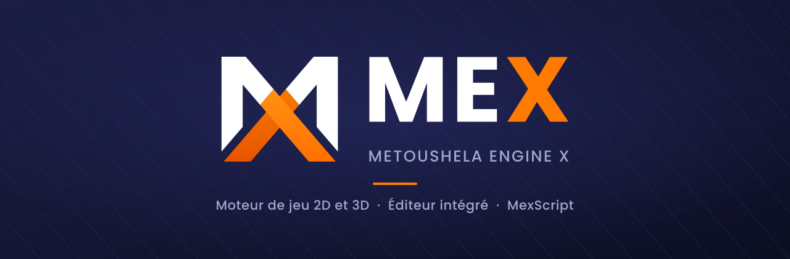
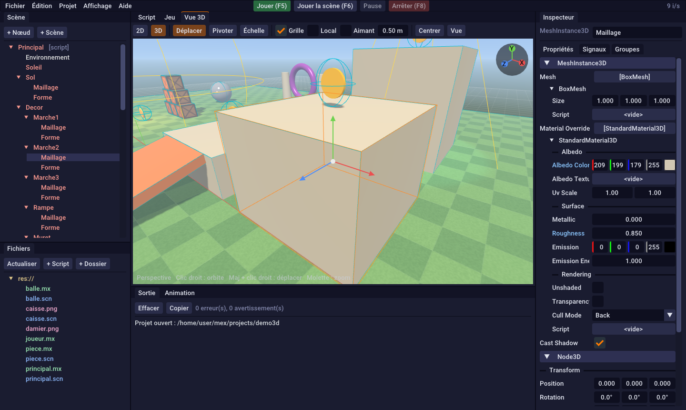
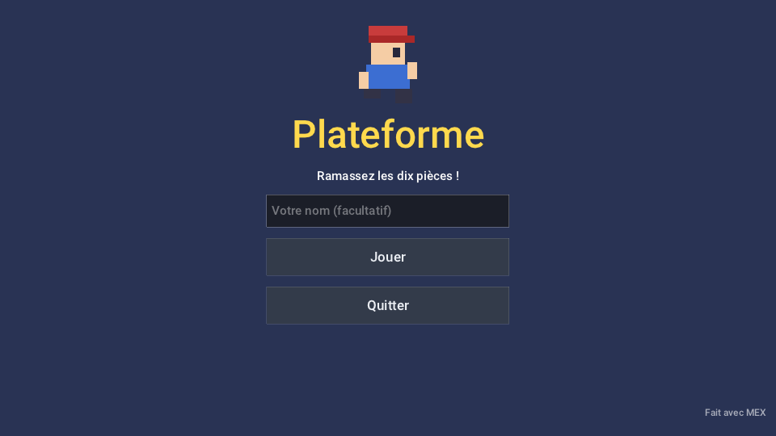
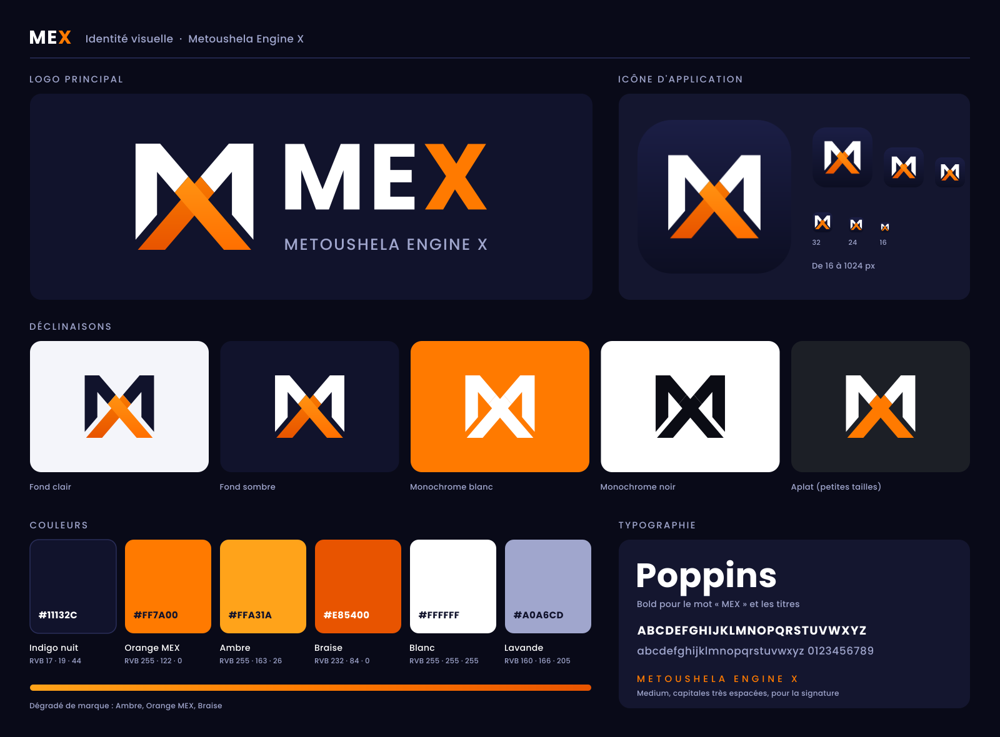

<p align="center"></p>

# MEX — Metoushela Engine X

**MEX** (*Metoushela Engine X*) est un moteur de jeu 2D et 3D écrit en C++17, avec son éditeur
et son langage de script, **MexScript**. Son architecture s'inspire de celle de Godot :
objets réfléchis (`Object` / `ClassDB`), `Variant`, arbre de nœuds, serveurs de rendu et de
physique, ressources, scènes au format texte, langage de script intégré, éditeur visuel,
animation, interface de jeu à ancres et conteneurs, export de jeux autonomes.




## Télécharger

Les versions compilées pour Windows, Linux et macOS sont publiées dans la page
**Releases** du dépôt GitHub (voir [Publier une version](#publier-une-version-avec-github)).
Chaque archive contient l'éditeur (`mex`), l'exécutable de jeu sans éditeur (`mex-jeu`),
les projets d'exemple et cette documentation. Aucune bibliothèque n'est à installer.

| Système | Archive | Après la décompression |
| --- | --- | --- |
| Windows 10 ou 11, 64 bits | `mex-<version>-windows-x86_64.zip` | Double-cliquez sur `mex.exe` |
| Linux x86_64, glibc 2.39 ou plus récente (Ubuntu 24.04, Debian 13, Fedora 40...) | `mex-<version>-linux-x86_64.tar.gz` | `./mex` |
| macOS 11 ou plus récent, Intel et Apple Silicon | `mex-<version>-macos-universal.tar.gz` | `xattr -dr com.apple.quarantine .` puis `./mex` |

Sous macOS, la commande `xattr` lève le blocage appliqué aux programmes téléchargés qui ne
sont pas signés par un développeur identifié. Sous Windows, SmartScreen peut afficher
« Windows a protégé votre ordinateur » : cliquez sur *Informations complémentaires* puis
*Exécuter quand même*.

## Compiler

Dépendances : un compilateur C++17, CMake 3.16 ou plus récent, SDL2. Le reste
(Dear ImGui, stb, police Roboto) est fourni dans `thirdparty/`.

La 3D utilise OpenGL 2.1, fourni par le pilote graphique : il n'y a ni en-tête ni
bibliothèque OpenGL à installer pour compiler, les fonctions sont résolues à l'exécution.

**Linux (Debian / Ubuntu)**

```sh
sudo apt install build-essential cmake ninja-build libsdl2-dev
cmake -S . -B build -G Ninja
cmake --build build
./build/bin/mex
```

**Windows (MSYS2)** : installez [MSYS2](https://www.msys2.org), ouvrez le terminal
« MSYS2 UCRT64 », puis :

```sh
pacman -S --needed mingw-w64-ucrt-x86_64-gcc mingw-w64-ucrt-x86_64-cmake mingw-w64-ucrt-x86_64-ninja
cmake -S . -B build -G Ninja -DMEX_VENDORED_SDL=ON -DMEX_STATIC_RUNTIME=ON
cmake --build build
./build/bin/mex.exe
```

**Windows (Visual Studio 2019 ou plus récent, avec vcpkg)**

```bat
vcpkg install sdl2:x64-windows
cmake -S . -B build -DCMAKE_TOOLCHAIN_FILE=C:/vcpkg/scripts/buildsystems/vcpkg.cmake
cmake --build build --config Release
build\bin\mex.exe
```

**macOS**

```sh
brew install cmake
cmake -S . -B build -DMEX_VENDORED_SDL=ON
cmake --build build --parallel
./build/bin/mex
```

**Windows depuis Linux (compilation croisée avec MinGW-w64)**

```sh
sudo apt install g++-mingw-w64-x86-64-posix
cmake -S . -B build/windows -G Ninja -DCMAKE_TOOLCHAIN_FILE=cmake/toolchain-mingw-w64.cmake \
    -DMEX_VENDORED_SDL=ON -DMEX_STATIC_RUNTIME=ON
cmake --build build/windows
```

La compilation produit deux exécutables dans `build/bin` : `mex` (moteur et éditeur) et
`mex-jeu` (moteur seul, copié par *Exporter le jeu*).

Options CMake :

| Option | Défaut | Rôle |
| --- | --- | --- |
| `MEX_BUILD_EDITOR` | `ON` | Inclut l'éditeur dans `mex`. `OFF` : `mex` est un exécutable de jeu seul. |
| `MEX_BUILD_TEMPLATE` | `ON` | Compile aussi `mex-jeu`. |
| `MEX_VENDORED_SDL` | `OFF` | Télécharge SDL2 2.32.10 et la lie statiquement : l'exécutable ne dépend plus d'une SDL2 installée. Sous Linux, `libsdl2-dev` reste utile pour les en-têtes de X11, Wayland et de l'audio. |
| `MEX_STATIC_RUNTIME` | `OFF` | GCC et MinGW : lie statiquement les bibliothèques du compilateur. Sous Windows, aucune DLL n'accompagne alors l'exécutable. |
| `MEX_WINDOWS_GUI` | `ON` | Windows : pas de fenêtre de console. Les messages restent visibles quand le programme est lancé depuis un terminal. |
| `MEX_VERSION` | `0.2.0` | Numéro de version affiché par `mex --version`. |
| `MEX_SANITIZE` | `OFF` | AddressSanitizer et UBSan (GCC / Clang). |

> Ce qui a été essayé : la compilation sous Linux avec GCC 14 et avec Clang 19 (libc++) ;
> la compilation croisée vers Windows avec MinGW-w64, dont les exécutables ont été lancés
> avec Wine. La 3D a été essayée sous Linux et sous Wine avec l'OpenGL logiciel de Mesa
> (llvmpipe), pas avec un pilote de carte graphique. Les compilations sous MSYS2, Visual
> Studio et macOS n'ont pas été essayées sur ces systèmes, et la 3D n'a tourné ni sur un
> vrai Windows ni sur macOS : pour ces systèmes, c'est GitHub Actions qui fait foi pour la
> compilation (voir [Publier une version](#publier-une-version-avec-github)), et le rendu
> 3D reste à vérifier sur une machine réelle.

## Lancer

```sh
mex                                    # gestionnaire de projets, puis éditeur
mex -e --path projects/plateforme      # ouvre le projet d'exemple dans l'éditeur
mex --path projects/plateforme         # lance le jeu
mex --path projects/demo3d             # lance la démonstration 3D
```

| Option | Rôle |
| --- | --- |
| `-e`, `--editor` | Ouvre l'éditeur |
| `--path <dossier>` | Dossier du projet (celui qui contient `project.mex`) |
| `<scène>` | Scène à lancer ou à ouvrir, par exemple `res://niveau.scn` |
| `--main-pack <f.pck>` | Lance le jeu contenu dans une archive exportée |
| `--quit-after <n>` | Quitte après `n` images |
| `--screenshot <f.bmp>` | Enregistre la dernière image |
| `--hidden` | Fenêtre masquée |

En jeu, F11 bascule le plein écran.

Le moteur demande à SDL son pilote de rendu `opengl`, dont la 3D a besoin. La variable
d'environnement `MEX_RENDER_DRIVER` en impose un autre (`software`, `direct3d`, `metal`...) :
la 2D fonctionne alors normalement, la 3D est désactivée et le moteur le signale.

## Premiers pas

1. Ouvrez le projet d'exemple dans l'éditeur. Depuis une archive téléchargée :
   `./mex -e --path projects/plateforme` (sous Windows, dans un terminal ouvert dans le
   dossier : `mex.exe -e --path projects\plateforme`). Après une compilation, l'exécutable
   est `build/bin/mex`.
2. Appuyez sur **F5** : le jeu démarre dans l'onglet *Jeu*. Cliquez dans l'image pour lui
   donner le clavier ; **F8** l'arrête.
3. Dans le dock *Fichiers*, double-cliquez sur `principal.scn`, sélectionnez `Niveau` puis
   *Peindre les tuiles* pour modifier le décor. Ctrl+S enregistre.
4. Sélectionnez `Joueur > Sprite` : le dock *Animation* liste ses animations ; *Lire* en
   montre un aperçu.
5. Pour la 3D, ouvrez l'autre exemple : `./mex -e --path projects/demo3d`. Le bouton droit
   de la souris fait tourner la vue ; cliquez sur un objet puis tirez une flèche du
   manipulateur pour le déplacer. **F5** lance la démonstration.
6. Pour créer votre propre jeu, lancez `mex` sans argument : dans le gestionnaire de
   projets, remplissez *Créer un nouveau projet* puis cliquez sur *Créer et ouvrir*.

Si la fenêtre ne s'ouvre pas, lancez la commande depuis un terminal : les erreurs y sont
affichées, précédées de `ERREUR:`.

## L'éditeur

| Dock | Rôle |
| --- | --- |
| Scène | Arbre des nœuds : ajout, renommage (F2), duplication (Ctrl+D), glisser-déposer pour changer de parent, instanciation de scènes |
| Vue 2D | Déplacer (Q), pivoter (E), redimensionner (R), centrer (F) ; molette pour zoomer, bouton du milieu ou droit pour déplacer la vue ; peinture de tuiles pour les `TileMap` |
| Vue 3D | Le même dock, qui passe en 3D quand un nœud 3D est sélectionné (boutons *2D* / *3D* pour forcer). Voir ci-dessous |
| Inspecteur | Propriétés, variables exportées des scripts, signaux et groupes |
| Fichiers | Fichiers du projet ; double-clic pour ouvrir, glisser vers la vue ou l'inspecteur |
| Script | Éditeur de texte avec indentation automatique et vérification à l'enregistrement |
| Jeu | Le jeu en cours d'exécution (F5 : projet, F6 : scène courante, F8 : arrêter) |
| Sortie | Messages, avertissements et erreurs |
| Animation | Animations du `AnimationPlayer` ou de l'`AnimatedSprite2D` sélectionné |

Ctrl+S enregistre, Ctrl+Z annule, Ctrl+Y rétablit. Les touches des actions se règlent dans
*Projet > Paramètres du projet > Contrôles*. *Projet > Exporter le jeu...* produit un jeu autonome.

Dans la vue 3D :

| Action | Commande |
| --- | --- |
| Tourner autour de la scène | Bouton droit ou bouton du milieu |
| Déplacer la vue | Maj + bouton droit ou du milieu |
| Zoomer | Molette |
| Sélectionner | Clic gauche |
| Déplacer / pivoter / mettre à l'échelle | Q / E / R, puis tirer une poignée du manipulateur (rouge : X, vert : Y, bleu : Z) |
| Centrer sur la sélection | F |
| Vues de face, de droite, de dessus | 1, 3, 7 du pavé numérique, ou menu *Vue* |
| Perspective / orthogonale | 5 du pavé numérique, ou menu *Vue* |

*Local* aligne le manipulateur sur le nœud plutôt que sur le monde, *Aimant* arrondit les
déplacements au pas indiqué ; Ctrl pendant une rotation l'arrondit à 15°. Les formes de
collision, les caméras et les lumières sont dessinées en fil de fer. Un fichier `.obj` ou
`.scn` glissé depuis le dock *Fichiers* est ajouté à la scène.

## Projets d'exemple

`projects/demo3d` est une démonstration 3D à la troisième personne :

- `principal.scn` : un décor de `StaticBody3D` (sol texturé, marches, rampe), un soleil avec
  ombres, une lampe (`OmniLight3D`) et un projecteur (`SpotLight3D`), un ciel et du
  brouillard (`WorldEnvironment`), un affichage 2D par-dessus la 3D (`CanvasLayer`) ;
- le joueur est un `CharacterBody3D` : déplacement relatif à la caméra, saut, caméra orbitale
  à la souris (`Input.set_mouse_mode`) qu'un `RayCast3D` rapproche devant les obstacles ;
- `caisse.scn` : des `RigidBody3D` empilés, que l'on pousse ou que l'on renverse en lançant
  des balles (`balle.scn`, instanciée par script) ;
- `piece.scn` : des pièces (`Area3D`) à ramasser.


`projects/plateforme` est un petit jeu de plateforme 2D :

- `menu.scn` : menu principal fait de conteneurs (`CenterContainer`, `VBoxContainer`), d'un
  champ de saisie (`LineEdit`) et de boutons ;
- `principal.scn` : un `TileMap` avec collisions, un `CharacterBody2D` piloté par script et
  animé par un `AnimatedSprite2D`, une `Camera2D`, un affichage du score dans un `CanvasLayer` ;
- `piece.scn` : une pièce (`Area2D`) instanciée dix fois, qui tourne grâce à un `AnimationPlayer`.




## Interface de jeu

Chaque `Control` se place par rapport à son parent avec des **ancres** (fractions de la zone
du parent, de 0 à 1) et des **marges** en pixels. Dans l'inspecteur, *Anchors Preset* propose
les cas courants : un coin, un bord, le centre, ou *Full Rect* pour occuper tout le parent.
Un contrôle n'est jamais plus petit que sa taille minimale (son texte, ou *Custom Minimum Size*).

Les **conteneurs** placent eux-mêmes leurs enfants :

| Conteneur | Disposition |
| --- | --- |
| `VBoxContainer`, `HBoxContainer` | En colonne ou en ligne, avec `separation` et `alignment` |
| `MarginContainer` | Enfant réduit par des marges sur les quatre côtés |
| `CenterContainer` | Enfant centré, à sa taille minimale |

Dans un conteneur, *Size Flags* règle le comportement de chaque enfant : remplir (*Fill*),
prendre la place restante (*Expand Fill*), ou garder sa taille minimale au début, au centre
ou à la fin (*Shrink ...*).

`LineEdit` est un champ de saisie sur une ligne : signaux `text_changed` et `text_submitted`
(touche Entrée), propriétés `text`, `placeholder_text`, `max_length`. Un clic lui donne le focus.

## Animation

**`AnimatedSprite2D`** joue les images d'une planche. Réglez `Hframes` et `Vframes` dans
l'inspecteur, puis décrivez les animations dans le dock *Animation* : première et dernière
image, images par seconde, boucle. En script : `$Sprite.play("course")`, `stop()`,
signaux `animation_finished` et `animation_looped`.

**`AnimationPlayer`** anime n'importe quelle propriété (position, échelle, couleur,
visibilité, numéro d'image...) avec des images clés :

1. Sélectionnez l'`AnimationPlayer`, cliquez sur *Nouvelle...* et réglez la durée.
2. Choisissez un nœud et une propriété, puis *Ajouter* : la piste est créée avec une première clé.
3. Déplacez le curseur de temps (clic sur la règle), modifiez la propriété dans la vue 2D ou
   l'inspecteur, puis cliquez sur *+ Clé*.
4. *Lire* montre le résultat dans la vue 2D.

Les nombres, `Vector2` et `Color` sont interpolés entre deux clés ; les autres valeurs changent
à l'instant de la clé. Les chemins des pistes partent du parent de l'`AnimationPlayer`.
Pendant l'aperçu, les propriétés animées prennent les valeurs de l'animation ; elles
retrouvent leur valeur d'origine avec *Terminer l'aperçu* et ne sont jamais enregistrées ainsi.
En script : `$AnimationPlayer.play("ouvrir")`, `stop()`, `seek(temps)`, signal `animation_finished`.


## Exporter un jeu

*Projet > Exporter le jeu...* crée un dossier à distribuer tel quel :

```
export/
  MonJeu          exécutable (MonJeu.exe sous Windows)
  MonJeu.pck      tous les fichiers du projet
```

Au lancement, l'exécutable charge l'archive `.pck` qui porte son nom (ou `data.pck`) et
démarre la scène principale. L'archive n'est ni compressée ni chiffrée.

- L'exécutable copié est par défaut `mex-jeu`, le moteur sans éditeur placé à côté de
  l'éditeur. S'il est absent, l'éditeur lui-même est copié.
- Pour exporter vers un autre système, indiquez dans la boîte de dialogue le `mex-jeu` de
  ce système, pris dans l'archive correspondante de la page *Releases* : `mex-jeu.exe`
  donne un jeu Windows, même depuis Linux ou macOS. Un jeu Linux ou macOS exporté depuis
  Windows doit être rendu exécutable chez le joueur (`chmod +x MonJeu`).
- Avec les exécutables des *Releases* (ou compilés avec `-DMEX_VENDORED_SDL=ON`), le
  joueur n'a rien à installer. Avec un exécutable lié à la SDL2 du système, SDL2 doit être
  présente chez le joueur ; sous Windows, les `.dll` placées à côté de l'exécutable (dont
  `SDL2.dll`) sont copiées dans le dossier d'export.
- Sous macOS, un jeu téléchargé demande la même commande `xattr` que le moteur
  (voir [Télécharger](#télécharger)).

## La 3D

Repère : main droite, Y vers le haut, une caméra regarde vers ses Z négatifs. Les unités
sont des mètres, les angles des radians (`rotation`) ou des degrés (`rotation_degrees`,
ordre d'Euler YXZ).

| Sujet | Ce qui existe |
| --- | --- |
| Maillages | `BoxMesh`, `SphereMesh`, `CylinderMesh`, `CapsuleMesh`, `PlaneMesh`, `TorusMesh` ; fichiers Wavefront `.obj` (positions, UV, normales ; les normales absentes sont calculées) |
| Matériaux | `StandardMaterial3D` : couleur et texture d'albédo, métal, rugosité, émission, transparence, sans éclairage, faces à masquer |
| Lumières | `DirectionalLight3D`, `OmniLight3D`, `SpotLight3D`, huit au plus par image ; ombres de la lumière directionnelle |
| Environnement | `Environment` : couleur de fond ou ciel en dégradé, lumière ambiante, brouillard |
| Caméra | `Camera3D` perspective ou orthogonale ; `unproject_position`, `project_ray_origin`, `project_ray_normal` |
| Physique | `StaticBody3D`, `CharacterBody3D` (`move_and_slide`, `is_on_floor`), `RigidBody3D` (impulsions, rebond, frottement, mise en sommeil), `Area3D`, `RayCast3D` ; formes sphère, boîte et capsule |

Une scène 3D n'est affichée que si elle contient une `Camera3D` dont `current` est coché.
Le rendu 3D est dessiné sous le canvas 2D : les nœuds 2D et l'interface restent utilisables
par-dessus. Exemple, simplifié depuis `projects/demo3d/joueur.mx` :

```gdscript
extends CharacterBody3D

@export var vitesse: float = 6.0
var lacet = 0.0
@onready var pivot = $Pivot

func _ready():
	Input.set_mouse_mode(Input.MOUSE_MODE_CAPTURED)

func _input(event):
	if event is InputEventMouseMotion:
		lacet -= event.relative.x * 0.004

func _physics_process(delta):
	pivot.rotation = Vector3(-0.3, lacet, 0)
	var saisie = Input.get_vector("gauche", "droite", "avancer", "reculer")
	var avant = Vector3(-sin(lacet), 0, -cos(lacet))
	var cote = Vector3(cos(lacet), 0, -sin(lacet))
	var direction = cote * saisie.x - avant * saisie.y
	velocity.x = direction.x * vitesse
	velocity.z = direction.z * vitesse
	if not is_on_floor():
		velocity.y -= 9.8 * delta
	elif Input.is_action_just_pressed("sauter"):
		velocity.y = 7.0
	move_and_slide()
```

Paramètres du projet (`project.mex`) : `physics/3d/gravity` (9.8), `rendering/3d/msaa`
(4), `rendering/3d/shadow_size` (2048), `rendering/3d/shadow_distance` (40).

## MexScript

Le langage de script ressemble à GDScript. Exemple, simplifié depuis `projects/plateforme/joueur.mx` :

```gdscript
extends CharacterBody2D

@export var vitesse: float = 260.0
@export var force_saut: float = 560.0

var gravite = 980.0
@onready var sprite = $Sprite

func _physics_process(delta):
	var direction = Input.get_axis("gauche", "droite")
	velocity.x = direction * vitesse
	if not is_on_floor():
		velocity.y += gravite * delta
	elif Input.is_action_just_pressed("sauter"):
		velocity.y = -force_saut
	move_and_slide()
	sprite.play("course" if abs(velocity.x) > 20 else "repos")
```

Pris en charge : `var`, `const`, `signal`, `enum`, `func`, `static func`, `@export`,
`@onready`, `if / elif / else`, `while`, `for ... in`, `match`, opérateur ternaire, lambdas
sur une ligne, `$Chemin/Du/Noeud`, annotations de type, paramètres par défaut.

Pas encore pris en charge : `await`, `extends "chemin"`, accesseurs `set / get`, `%Nom`,
opérateur `**`.

Fonctions appelées par le moteur : `_init`, `_ready`, `_process(delta)`,
`_physics_process(delta)`, `_input(event)`, `_unhandled_input(event)`, `_draw`.

## Nœuds disponibles

| Famille | Classes |
| --- | --- |
| Base | `Node`, `Timer`, `CanvasLayer`, `AudioStreamPlayer`, `AnimationPlayer` |
| 2D | `Node2D`, `Marker2D`, `Sprite2D`, `AnimatedSprite2D`, `Camera2D`, `TileMap`, `RayCast2D` |
| Physique 2D | `StaticBody2D`, `CharacterBody2D`, `RigidBody2D`, `Area2D`, `CollisionShape2D` |
| Formes 2D | `RectangleShape2D`, `CircleShape2D`, `CapsuleShape2D`, `ConvexPolygonShape2D` |
| 3D | `Node3D`, `Marker3D`, `MeshInstance3D`, `Camera3D`, `DirectionalLight3D`, `OmniLight3D`, `SpotLight3D`, `WorldEnvironment`, `RayCast3D` |
| Physique 3D | `StaticBody3D`, `CharacterBody3D`, `RigidBody3D`, `Area3D`, `CollisionShape3D` |
| Formes 3D | `SphereShape3D`, `BoxShape3D`, `CapsuleShape3D` |
| Interface | `Control`, `Label`, `Button`, `LineEdit`, `Panel`, `ColorRect`, `TextureRect`, `ProgressBar` |
| Conteneurs | `VBoxContainer`, `HBoxContainer`, `MarginContainer`, `CenterContainer` |

Formats de fichiers : images PNG, JPEG, BMP, TGA et GIF, sons WAV, polices TTF, maillages OBJ, scènes `.scn`,
ressources `.res`, scripts `.mx`, archives de jeu `.pck`.

## Organisation du code

| Dossier | Contenu |
| --- | --- |
| `core/` | `Variant`, `Object`, `ClassDB`, chaînes, mathématiques, entrées, fichiers, archives `.pck`, paramètres du projet |
| `servers/` | Fenêtre (SDL2), rendu 2D, rendu 3D (OpenGL 2.1), physique 2D et 3D, audio |
| `scene/` | Nœuds 2D (`2d/`) et 3D (`3d/`), `SceneTree`, interface (`gui/`), animation, ressources, scènes empaquetées |
| `modules/mexscript/` | Analyseur et interpréteur du langage de script |
| `editor/` | Éditeur (Dear ImGui) |
| `main/` | Point d'entrée et boucle de jeu |
| `cmake/` | Fichier de compilation croisée vers Windows |
| `platform/` | Ressources propres à chaque système : icône et version de l'exécutable Windows, lanceur Linux |
| `branding/` | Identité visuelle : logos, icônes, charte graphique et le programme qui les génère |
| `.github/workflows/` | Compilation et publication automatiques (GitHub Actions) |
| `projects/` | Projets d'exemple |
| `thirdparty/` | Bibliothèques tierces |

Le code suit les conventions de Godot : `GDCLASS`, `_bind_methods`, `ClassDB::bind_method`,
`ADD_PROPERTY`, `ADD_SIGNAL`, préfixe `p_` pour les paramètres. Les commentaires sont en
français.

## Limites actuelles

- 2D : rendu par `SDL_Renderer`, sans shaders ni lumières.
- 3D : rendu direct en OpenGL 2.1, sans réflexions du ciel, éclairage global ni
  post-traitement ; seule la lumière directionnelle projette des ombres ; pas de shaders
  écrits par l'utilisateur ; pas de squelettes ni d'animation de maillages ; import OBJ
  seulement (pas de glTF), sans lecture des fichiers `.mtl`.
- Physique 3D : sphères, boîtes et capsules uniquement (pas de maillages de collision ni de
  formes convexes quelconques), pas d'articulations, pas de détection continue : un objet
  petit et très rapide peut traverser une paroi mince.
- Éditeur 3D : une seule vue, pas de sélection multiple, pas d'aperçu de la caméra du jeu.
  Dans l'onglet *Jeu*, la souris n'est pas capturée (`Input.set_mouse_mode` n'agit que dans
  le jeu lancé hors de l'éditeur) : la caméra suit la souris tant qu'elle survole l'image.
- Interface de jeu : pas de thèmes, de défilement (`ScrollContainer`), de grille ni de texte
  multiligne éditable ; le focus clavier ne passe pas d'un contrôle à l'autre avec Tab.
- Animation : interpolation linéaire uniquement, pas de pistes d'appel de méthode ni de
  fondu entre deux animations.
- Export : pas d'icône d'application, de paquet `.app` pour macOS ni de compression de l'archive ;
  les exécutables ne sont pas signés.
- Pas de particules. Audio : WAV uniquement.

## Publier une version avec GitHub

Le fichier `.github/workflows/build.yml` fait compiler le moteur par GitHub Actions pour
Linux, Windows et macOS. Il n'y a rien à installer sur votre machine à part `git`.

**Première mise en ligne.** Créez un dépôt vide sur <https://github.com/new> (sans README
ni licence), puis, dans le dossier du moteur :

```sh
git init -b main
git add .
git commit -m "MEX 0.2.0"
git remote add origin https://github.com/VOTRE_COMPTE/VOTRE_DEPOT.git
git push -u origin main
```

Chaque envoi sur `main` lance la compilation des trois systèmes. Le résultat se suit dans
l'onglet **Actions** du dépôt ; les archives produites se téléchargent au bas de la page
d'une exécution, dans *Artifacts*.

**Publier une version.** Posez une étiquette qui commence par `v` et envoyez-la :

```sh
git tag v0.2.0
git push origin v0.2.0
```

Le même travail se relance puis crée la *Release* `v0.2.0` avec :

- `mex-v0.2.0-windows-x86_64.zip`
- `mex-v0.2.0-linux-x86_64.tar.gz`
- `mex-v0.2.0-macos-universal.tar.gz`
- `SHA256SUMS.txt`, les empreintes des archives.

Le numéro de l'étiquette devient celui qu'affiche `mex --version`. Une étiquette avec un
tiret, par exemple `v0.2.0-beta1`, donne une préversion. Si la compilation d'un système
échoue, les autres archives sont tout de même publiées et la note de version le signale.

Ce que fait chaque compilation :

| Système | Machine GitHub | Compilateur | Particularités |
| --- | --- | --- | --- |
| Linux | `ubuntu-24.04` | GCC | SDL2 et bibliothèques du compilateur liées statiquement |
| Windows | `windows-latest` | GCC de MSYS2 (UCRT64) | Un seul `.exe`, aucune DLL à fournir |
| macOS | `macos-latest` | Clang d'Apple | Une compilation par architecture, réunies avec `lipo` ; signature locale (`codesign -`) |

Après la compilation, les deux projets d'exemple tournent 120 images sans écran sur chaque
système ; la moindre ligne `ERREUR:` fait échouer le travail. Sans écran il n'y a pas
d'OpenGL : cet essai couvre les scripts et la physique, pas le rendu 3D. Sous Linux, une
étape supplémentaire lance la démonstration 3D avec un écran virtuel (`xvfb`) et l'OpenGL
logiciel de Mesa, et échoue si le rendu 3D ne démarre pas.

## Tests automatiques

La variable d'environnement `MEX_EDITOR_TEST_SCRIPT` désigne un fichier d'entrées simulées,
une commande par ligne sous la forme `<image> <commande> [arguments]` :

```
4 move 75 372
5 click
8 key s ctrl
12 shot /tmp/capture.bmp
```

Commandes : `move x y`, `down`, `up`, `click [bouton]`, `wheel dy`, `key <touche> [ctrl] [shift]`,
`keydown`, `keyup`, `text <chaîne>` (31 octets au plus par commande), `shot <fichier.bmp>`.
Avec `SDL_VIDEODRIVER=dummy`, l'éditeur tourne sans écran (et donc sans rendu 3D ; pour
la 3D, utilisez un écran virtuel : `xvfb-run -a mex ...`).

Le jeu seul accepte le même format avec `MEX_TEST_SCRIPT` (coordonnées en pixels du jeu) :
`move`, `down`, `up`, `click`, `keydown`, `keyup`, `key`, `text`, `shot`.

```sh
MEX_TEST_SCRIPT=essai.txt SDL_VIDEODRIVER=dummy SDL_AUDIODRIVER=dummy \
    mex --path projects/plateforme --quit-after 120
```

## Identité visuelle

<p align="center"></p>

Le logo réunit le **M** de Metoushela et le **X** du moteur. Le dossier `branding/` contient
les logos vectoriels (fond sombre, fond clair, monochrome), l'icône de 16 à 1024 px, les
fichiers `mex.ico` et `mex.icns`, et la [charte graphique](branding/CHARTE.md) : couleurs,
typographie, zone de protection, tailles minimales, usages à éviter.

Tout est dessiné par le programme `branding/generer_marque.py` ; il met aussi à jour l'icône
embarquée dans le moteur (`main/mex_logo.gen.h`) et celle de l'exécutable Windows
(`platform/windows/mex.ico`).

L'éditeur et les jeux affichent l'icône de MEX dans leur fenêtre. Pour donner sa propre icône à
un jeu, indiquez une image du projet dans *Projet → Paramètres du projet → Icône de la fenêtre*
(paramètre `application/icon` de `project.mex`, par exemple `res://icone.png`).

Sous Linux, pour ajouter MEX au menu des applications :

```bash
install -Dm644 mex.png ~/.local/share/icons/hicolor/256x256/apps/mex.png
install -Dm644 mex.desktop ~/.local/share/applications/mex.desktop   # adaptez la ligne Exec au chemin de mex
```

Depuis les sources, ces deux fichiers sont `branding/png/mex-icone-256.png` et
`platform/linux/mex.desktop`.

## Licences des bibliothèques tierces

| Bibliothèque | Licence |
| --- | --- |
| [SDL2](https://www.libsdl.org) | zlib |
| [Dear ImGui](https://github.com/ocornut/imgui) 1.93 (branche docking) | MIT, voir `thirdparty/imgui/LICENSE.txt` |
| [stb_image, stb_truetype](https://github.com/nothings/stb) | Domaine public ou MIT, voir `thirdparty/stb/LICENSE.txt` |
| Police Roboto Medium (Christian Robertson) | Apache 2.0, voir `thirdparty/fonts/LICENSE.txt` |
| Police Poppins (Indian Type Foundry), utilisée pour dessiner le logo | SIL Open Font License 1.1, voir `branding/polices/OFL.txt` |
