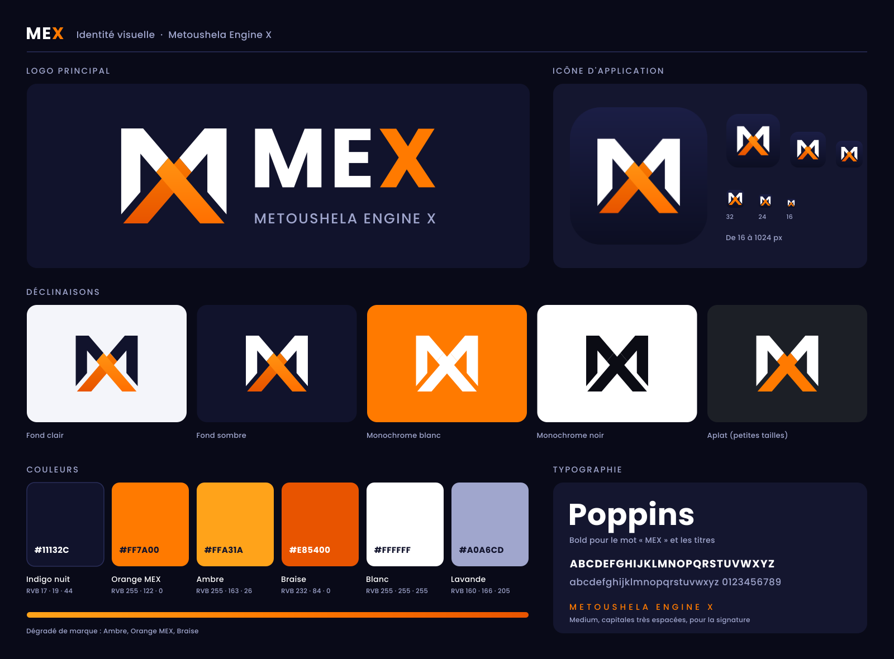
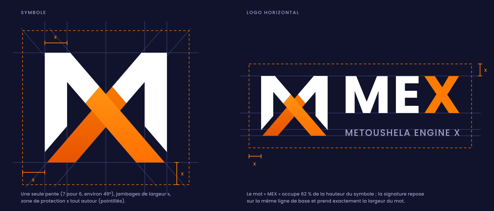
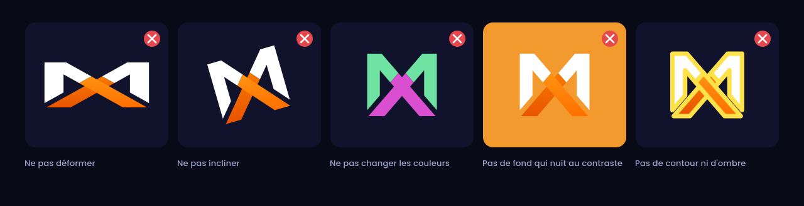

# MEX — charte graphique

<p align="center"></p>

**MEX** signifie **Metoushela Engine X**. Le nom porte celui de son créateur ; le logo le dit
en un seul signe : un **M** blanc, solide, traversé par un **X** orange qui en prolonge les
obliques. Le M est la personne et la structure, le X est le moteur : l'énergie, le croisement
des axes, l'inconnue qu'on résout.

## 1. Le nom

| Usage | Écriture |
| --- | --- |
| Nom courant | **MEX** (toujours en capitales) |
| Nom complet, première mention | **MEX — Metoushela Engine X** |
| Langage de script | **MexScript** (extension `.mx`) |
| Exécutables | `mex` (éditeur), `mex-jeu` (jeu seul) |

À éviter : « Mex », « mex engine », « MEX Engine » (le E signifie déjà *Engine*).

## 2. Le logo

| Fichier (`svg/` et `png/`) | Quand l'utiliser |
| --- | --- |
| `mex-logo-horizontal` | Version principale : en-têtes, documentation, site |
| `mex-logo-vertical` | Formats carrés ou étroits : écran de démarrage, affiche, avatar large |
| `mex-symbole` | Quand le nom est déjà écrit à côté, ou que la place manque |
| `mex-icone` | Icône d'application (fond Indigo nuit intégré) |
| `mex-banniere` | En-tête du dépôt et des pages de présentation |

Chaque logo existe pour **fond sombre** (sans suffixe : M blanc) et pour **fond clair**
(suffixe `-clair` : M Indigo nuit). Le symbole existe aussi en **monochrome**
(`-blanc`, `-noir`) pour la gravure, le tampon, l'impression en une couleur ou les fonds colorés.

Les fichiers SVG sont la référence : ils sont vectoriels, nets à toutes les tailles, et leurs
textes sont convertis en tracés (aucune police à installer).

## 3. Construction et zone de protection

<p align="center"></p>

- Tout le symbole est tracé avec **une seule pente** (7 pour 6, environ 49°) : les obliques du M
  et les jambes du X sont parallèles deux à deux, et le X prolonge exactement le M.
- Le module **x** est la largeur d'un jambage vertical du M (environ un cinquième de la hauteur
  du symbole).
- **Zone de protection** : laisser au moins **x** de vide autour du logo. Les fichiers fournis
  contiennent déjà cette marge.
- Dans le logo horizontal, le mot « MEX » occupe 62 % de la hauteur du symbole ; la signature
  repose sur la ligne de base du symbole et prend exactement la largeur du mot.

### Tailles minimales

| Élément | Écran | Impression |
| --- | --- | --- |
| Logo horizontal ou vertical, avec signature | 160 px de large | 40 mm |
| Symbole | 16 px | 5 mm |
| Icône d'application | 16 px | — |

En dessous de la taille minimale du logo, la signature n'est plus lisible : utiliser le symbole
seul.

En dessous de 48 px, l'icône utilise un dessin adapté (`mex-icone-petit.svg`) : symbole plus
grand et orange en aplat, pour rester lisible. Les fichiers `mex.ico` et `mex.icns` font ce
choix automatiquement.

## 4. Couleurs

| Couleur | Hex | RVB | Rôle |
| --- | --- | --- | --- |
| **Indigo nuit** | `#11132C` | 17, 19, 44 | Fond principal, texte sur fond clair |
| **Orange MEX** | `#FF7A00` | 255, 122, 0 | Accent : le X, les éléments actifs |
| Ambre | `#FFA31A` | 255, 163, 26 | Haut du dégradé orange |
| Braise | `#E85400` | 232, 84, 0 | Bas du dégradé orange |
| Blanc | `#FFFFFF` | 255, 255, 255 | Le M, le texte sur fond sombre |
| Lavande | `#A0A6CD` | 160, 166, 205 | Texte secondaire sur fond sombre |
| Ardoise | `#2A2E5A` | 42, 46, 90 | Filets, panneaux |
| Brume | `#F4F5FA` | 244, 245, 250 | Fond clair |

Proportions conseillées : environ **70 % d'indigo, 20 % de blanc, 10 % d'orange**. L'orange est
un accent : il perd sa force s'il couvre tout.

Dégradé de marque : Ambre → Orange MEX → Braise, toujours du clair (haut) vers le foncé (bas).
Fond de l'icône : `#1B1E45` (haut) → `#0C0E22` (bas).

Contrastes (rapport WCAG 2) : blanc sur Indigo nuit 18,2 ; Orange MEX sur Indigo nuit 7,0 ;
Lavande sur Indigo nuit 7,7 ; Indigo nuit sur Brume 16,7. L'Orange MEX sur blanc ne fait que
2,6 : ne pas l'employer pour du texte courant sur fond clair, seulement pour le logo et les
grands titres.

## 5. Typographie

**Poppins** (Indian Type Foundry, licence SIL Open Font 1.1, fournie dans `polices/`).

| Usage | Graisse | Réglage |
| --- | --- | --- |
| Mot « MEX », titres | Bold | Capitales, approche légèrement ouverte |
| Signature « METOUSHELA ENGINE X » | Medium | Capitales très espacées |
| Texte courant des supports de communication | Regular ou Medium | — |

L'interface de l'éditeur garde la police Roboto, plus lisible en petit corps ; elle reprend les
couleurs de la marque (fonds indigo, accent orange).

## 6. Usages à éviter

<p align="center"></p>

- Ne pas étirer ni écraser le logo ; toujours conserver ses proportions.
- Ne pas l'incliner ni le faire pivoter.
- Ne pas changer ses couleurs en dehors des versions fournies.
- Ne pas le poser sur un fond orange ou chargé : utiliser alors la version monochrome.
- Ne pas ajouter de contour, d'ombre portée ou d'effet de relief.
- Ne pas recomposer le mot « MEX » dans une autre police.

## 7. Les fichiers

```
branding/
  CHARTE.md              ce document
  planche.png            la marque sur une page
  construction.png       construction et zone de protection
  interdits.png          usages à éviter
  svg/                   logos vectoriels (référence)
  png/                   logos en PNG, icône de 16 à 1024 px
  mex.ico                icône Windows (16, 24, 32, 48, 64, 128, 256 px)
  mex.icns               icône macOS
  polices/               Poppins Bold et Medium, et leur licence
  generer_marque.py      le programme qui dessine tout
```

Tout est généré par `generer_marque.py` à partir de quelques mesures : pour modifier une
couleur ou une proportion, changez-la en tête du programme puis relancez-le.

```bash
pip install fonttools pillow        # et le paquet librsvg2-bin pour rsvg-convert
python3 branding/generer_marque.py
```

Il met aussi à jour les fichiers que le moteur embarque : `main/mex_logo.gen.h` (icône de la
fenêtre et logo de l'éditeur) et `platform/windows/mex.ico` (icône de `mex.exe`).

## 8. Dans le moteur

- **Fenêtre** : l'icône de MEX est celle de l'éditeur et, par défaut, celle des jeux. Un jeu
  affiche la sienne avec le paramètre `application/icon` de `project.mex` (une image du projet,
  par exemple `res://icone.png`).
- **Windows** : `mex.exe` et `mex-jeu.exe` portent l'icône et les informations de version
  (`platform/windows/mex.rc.in`).
- **Linux** : `platform/linux/mex.desktop` et l'icône `branding/png/mex-icone-256.png` (fournie
  sous le nom `mex.png` dans l'archive Linux) pour ajouter MEX au menu des applications.
- **Éditeur** : le thème par défaut, « MEX Nuit », reprend l'indigo et l'orange de la marque ;
  les autres thèmes (Ardoise bleue, Graphite, Minuit, Aurore, Forêt, Clair, Contraste élevé,
  Personnalisé) changent les couleurs de l'interface, jamais celles du logo. Le logo figure
  dans le gestionnaire de projets, la barre de menus et *Aide → À propos de MEX*.
- **Icônes de l'éditeur** : jeu d'icônes au trait Lucide (licence ISC), d'épaisseur constante,
  teintées par le thème. Elles ne remplacent jamais le logo.
